# Cẩm nang vẽ sơ đồ OOAD — dự án Workflow Pipeline Engine

Cẩm nang này dùng cho các task T1, A7–D8, X3, X4. Mỗi loại sơ đồ có: dùng khi nào, ký hiệu phải nhớ, lỗi hay bị trừ điểm, ví dụ lấy từ chính dự án, và checklist để tự chấm.

**Mục lục**
- [0. Cách học bằng cẩm nang này](#0-cách-học-bằng-cẩm-nang-này)
- [1. Công cụ và quy ước](#1-công-cụ-và-quy-ước)
- [2. Phân tích, thiết kế, kiến trúc: sơ đồ nào ở giai đoạn nào](#2-phân-tích-thiết-kế-kiến-trúc-sơ-đồ-nào-ở-giai-đoạn-nào)
- [3. Từng loại sơ đồ](#3-từng-loại-sơ-đồ) — 3.1 Use case · 3.2 Đặc tả use case · 3.3 Activity · 3.4 Sequence · 3.5 Communication · 3.6 Class · 3.7 State machine · 3.8 Component · 3.9 Deployment · 3.10 Package · 3.11 Object · 3.12 ERD · 3.13 BFD
- [4. Ma trận nhất quán giữa các sơ đồ](#4-ma-trận-nhất-quán-giữa-các-sơ-đồ)
- [5. Mẫu thiết kế và nguyên lý OOP có trong dự án](#5-mẫu-thiết-kế-và-nguyên-lý-oop-có-trong-dự-án)
- [6. Ngân hàng câu hỏi vấn đáp](#6-ngân-hàng-câu-hỏi-vấn-đáp)

> Các ví dụ PlantUML trong file này **chưa được render thử** lúc viết. Sơ đồ nào báo lỗi cú pháp khi chạy thì sửa và ghi chú lại cho nhóm.

---

## 0. Cách học bằng cẩm nang này

Sơ đồ nào cũng làm theo 4 bước:
1. **Đọc**: đặc tả (với sơ đồ phân tích) hoặc code thật (với sơ đồ thiết kế).
2. **Vẽ tay**, không dùng AI. Giấy hoặc draw.io đều được. Đây là bước học thật sự.
3. **Tự chấm** theo checklist của loại sơ đồ đó. Mỗi mục đạt được 1 điểm, quy về thang 10: `điểm = số mục đạt / tổng số mục × 10`.
4. **Nhờ soát** (người review hoặc Claude), **tự sửa**, rồi mới chép sang công cụ.

Hai nguyên tắc chấm:
- Sơ đồ phân tích phải khớp **đặc tả** (`docs/specs/`, integration map).
- Sơ đồ thiết kế phải khớp **code**: mọi tên lớp, tên phương thức đều tìm được bằng `grep`.

---

## 1. Công cụ và quy ước

**Công cụ**
- Giảng viên bắt dùng công cụ nào (StarUML, Visual Paradigm, Enterprise Architect, draw.io) thì bản nộp dùng công cụ đó.
- Giảng viên không bắt thì dùng **PlantUML**. Sơ đồ là file text, nên review được trong PR và soát lỗi được bằng Claude.
  - VS Code: cài extension "PlantUML" (tác giả jebbs). Cần Java (máy nhóm đã có).
  - Một số loại sơ đồ cần Graphviz. Báo thiếu Graphviz thì cài Graphviz, hoặc thêm dòng `!pragma layout smetana` ngay sau `@startuml`.
  - Xem trước: `Alt+D`. Xuất PNG: lệnh "PlantUML: Export Current Diagram".
  - Không dán sơ đồ chứa dữ liệu nhạy cảm lên server PlantUML công khai.
- Sơ đồ communication: PlantUML không có loại riêng (xem 3.5). Giảng viên chấm kỹ ký hiệu thì vẽ loại này bằng draw.io hoặc StarUML.

**Thư mục và tên file**
- `docs/ooad/A-tai-khoan/`, `B-do-thi/`, `C-thuc-thi/`, `D-du-an/`, `he-thong/`, `luyen-tap/`
- PNG để ở `docs/ooad/png/<chữ người vẽ>-<tên file>.png`
- Tiền tố tên file: `uc-`, `dac-ta-uc.md`, `activity-`, `seq-`, `comm-`, `bce-`, `class-`, `state-`, `component-`, `deployment-`, `package-`, `object-`, `erd-`

**Cách đặt tên trong sơ đồ**
- Use case và hành động: tiếng Việt, dạng "động từ + danh từ" (Nộp bài, Duyệt bài).
- Sơ đồ thiết kế: giữ **đúng** tên lớp và phương thức trong code (tiếng Anh).

---

## 2. Phân tích, thiết kế, kiến trúc: sơ đồ nào ở giai đoạn nào

| Giai đoạn | Câu hỏi trả lời | Sơ đồ | Mức chi tiết | Task |
| :--- | :--- | :--- | :--- | :--- |
| Phân tích | Hệ thống làm gì, cho ai? | Use case, đặc tả use case, activity, class phân tích (BCE) | Tên nghiệp vụ; chưa có kiểu dữ liệu, chưa có framework | A7, B7, C7, D7 |
| Thiết kế | Làm bằng những lớp nào, gọi nhau ra sao? | Sequence, communication, class thiết kế, state | Tên lớp và phương thức thật, kiểu dữ liệu, visibility | A8, B8, C8, D8 |
| Kiến trúc | Hệ thống gồm những khối nào, chạy ở đâu? | Component, deployment, package, class miền, ERD, object | Khối, nút máy, giao thức, bảng | X3 |

Giảng viên hay hỏi: "Sơ đồ này thuộc giai đoạn nào? Vì sao chưa có hoặc đã có kiểu dữ liệu?"

---

## 3. Từng loại sơ đồ

### 3.1 Use case

**Dùng khi:** mô tả các chức năng của hệ thống, nhìn từ phía người dùng.

**Ký hiệu phải nhớ**
- **Actor** (hình người): một *vai trò*, không phải một người cụ thể. Actor có thể là hệ thống bên ngoài hoặc thời gian (ví dụ "Bộ hẹn giờ").
- **Use case** (hình elip): một *mục tiêu có giá trị* với actor. Tên dạng "động từ + danh từ".
- **Ranh giới hệ thống** (hình chữ nhật có tên hệ thống): use case nằm trong, actor nằm ngoài.
- **Association** (nét liền): nối actor với use case.
- `<<include>>` (nét đứt): mũi tên **từ use case gốc tới use case được include**. Hành vi được include **luôn** xảy ra.
- `<<extend>>` (nét đứt): mũi tên **từ use case mở rộng tới use case gốc**. Hành vi mở rộng **chỉ** xảy ra khi thỏa điều kiện; ghi điều kiện lên mũi tên.
- **Tổng quát hóa** (nét liền, đầu tam giác rỗng): mũi tên từ con tới cha (giữa actor với actor, hoặc use case với use case).

**Lỗi hay bị trừ điểm**
1. Use case là một bước nhỏ hay một thao tác giao diện ("Bấm nút Lưu", "Nhập mật khẩu") thay vì một mục tiêu.
2. Vẽ ngược chiều include hoặc extend.
3. Dùng include/extend để thể hiện thứ tự các bước, biến sơ đồ use case thành flowchart.
4. Nối actor với actor, hoặc use case với use case, bằng association thường.
5. Thiếu ranh giới hệ thống, hoặc đặt actor nằm trong ranh giới.
6. Vẽ "Đăng nhập" là include của mọi use case. Đúng ra đăng nhập là **tiền điều kiện**, ghi trong đặc tả.
7. Đặt actor bằng tên người thật ("Alex Kim").

**Ví dụ (mảng C, rút gọn)**
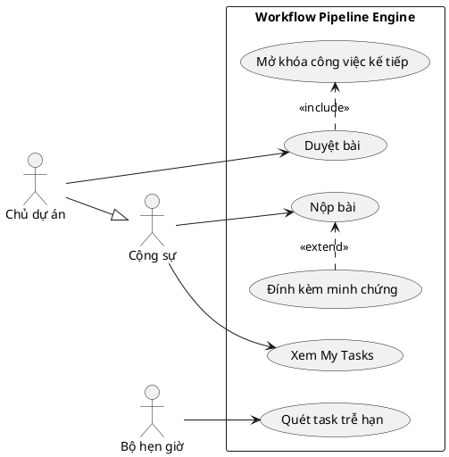
Đọc ví dụ: Chủ dự án kế thừa mọi use case của Cộng sự. "Đính kèm minh chứng" chỉ xảy ra khi người nộp có link. Duyệt bài thì **luôn** kéo theo việc thử mở khóa công việc kế tiếp.

**Checklist (10 mục)**
- [ ] Có ranh giới hệ thống ghi tên hệ thống.
- [ ] Mỗi actor là một vai trò, nằm ngoài ranh giới.
- [ ] Tên use case dạng "động từ + danh từ" và là mục tiêu của actor.
- [ ] include: mũi tên đi từ use case gốc tới use case được include.
- [ ] extend: mũi tên đi từ use case mở rộng tới use case gốc, có ghi điều kiện.
- [ ] Tổng quát hóa đúng chiều (con → cha), đầu tam giác rỗng.
- [ ] Không có association actor–actor hay use case–use case.
- [ ] "Đăng nhập" không bị vẽ thành include của mọi use case.
- [ ] Mọi use case khớp ma trận RBAC (`docs/specs/system-overview.md` mục 4), hoặc có giải thích.
- [ ] Sơ đồ dễ đọc (khoảng 15 use case trở xuống; nhiều hơn thì tách sơ đồ).

### 3.2 Đặc tả use case

**Mẫu**
```markdown
## UC: <Tên use case>
- Mã: UCx (khớp ma trận RBAC)
- Actor chính: …   Actor phụ: …
- Mô tả ngắn: …
- Tiền điều kiện: … (ví dụ: đã đăng nhập, là thành viên dự án)
- Hậu điều kiện khi thành công: …
- Luồng chính:
  1. Actor …
  2. Hệ thống …
- Luồng thay thế:
  - 2a. Nếu … thì …
- Luồng ngoại lệ:
  - E1. … → hệ thống báo lỗi `<MÃ_LỖI>`, use case kết thúc.
- Quy tắc nghiệp vụ: BR1 …
```

**Ví dụ rút gọn: "Nộp bài"**
- Tiền điều kiện: đã đăng nhập; task ở `IN_PROGRESS`; người dùng là người phụ trách hoặc Chủ dự án.
- Luồng chính: 1. Cộng sự chọn "Nộp bài". 2. Hệ thống hiện hộp thoại. 3. Cộng sự nhập link minh chứng (không bắt buộc) và xác nhận. 4. Hệ thống chuyển task sang `REVIEW`, lưu minh chứng, gửi thông báo cho Chủ dự án.
- Luồng thay thế: 3a. Không nhập link → bỏ qua bước lưu minh chứng.
- Luồng ngoại lệ: E1. Version không khớp → `409 OPTIMISTIC_LOCK_CONFLICT`. E2. Không phải người phụ trách hay owner → `403 ACCESS_DENIED`.

**Lỗi hay gặp:** luồng chính viết toàn hành động của hệ thống, hoặc toàn hành động của actor (phải xen kẽ actor và hệ thống); thiếu luồng ngoại lệ; đưa tiền điều kiện vào thành một bước của luồng; tả giao diện quá chi tiết.

**Checklist (7 mục)**
- [ ] Có đủ: mã, actor, tiền điều kiện, hậu điều kiện, luồng chính, luồng thay thế, luồng ngoại lệ.
- [ ] Luồng chính xen kẽ actor và hệ thống, đánh số.
- [ ] Luồng thay thế và ngoại lệ ghi rõ bắt đầu từ bước nào (2a, E1…).
- [ ] Mã lỗi khớp code hoặc integration map Chương III.
- [ ] Tiền điều kiện không lặp lại thành bước trong luồng.
- [ ] Không tả chi tiết giao diện (màu sắc, vị trí nút).
- [ ] Tên use case trùng với tên trong sơ đồ use case.

### 3.3 Activity

**Dùng khi:** mô tả một luồng công việc hoặc một quy trình, có rẽ nhánh và có việc chạy song song.

**Ký hiệu phải nhớ**
- Nút bắt đầu (chấm đen), nút kết thúc hoạt động (chấm đen có viền), nút kết thúc luồng (vòng tròn có dấu ×).
- Hành động: hình chữ nhật bo góc.
- Quyết định và gộp nhánh (hình thoi). Mỗi nhánh ra ghi điều kiện trong `[ ]`, các điều kiện phải phủ hết mọi khả năng.
- Fork và join (thanh đen): tách ra nhiều việc chạy song song, rồi chờ tất cả xong.
- Swimlane (làn): mỗi làn là một actor hoặc một bộ phận.

**Lỗi hay bị trừ điểm:** nhánh thiếu điều kiện hoặc điều kiện không phủ hết; có fork mà không có join; đặt hành động sai làn; đặt tên hành động như trạng thái ("Đang chờ duyệt" là trạng thái, không phải hành động); vẽ chi tiết giao diện.

**Ví dụ: "Nộp bài"**
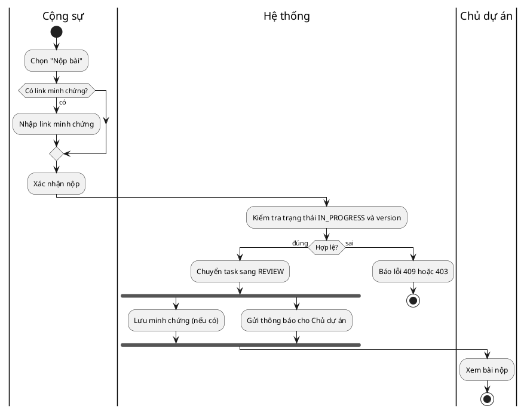

**Checklist (8 mục)**
- [ ] Có đúng 1 nút bắt đầu, có ít nhất 1 nút kết thúc.
- [ ] Hành động dạng "động từ + danh từ".
- [ ] Mọi nhánh ra khỏi hình thoi đều ghi điều kiện, phủ hết các khả năng.
- [ ] Nhánh rẽ ra thì có điểm gộp lại, hoặc kết thúc rõ ràng.
- [ ] Mỗi fork đều có join.
- [ ] Mỗi hành động nằm đúng làn của người hoặc bộ phận làm việc đó.
- [ ] Khớp luồng chính và luồng thay thế trong đặc tả use case.
- [ ] Không lẫn trạng thái vào thành hành động.

### 3.4 Sequence

**Dùng khi:** mô tả các đối tượng gọi nhau **theo thứ tự thời gian** để thực hiện một use case.

**Ký hiệu phải nhớ**
- Lifeline: `:TênLớp` hoặc `tên:TênLớp`. Đó là một **đối tượng**, không phải lớp.
- Thanh kích hoạt (activation): khoảng thời gian đối tượng đang xử lý.
- Message **đồng bộ**: nét liền, đầu mũi tên đặc (`->` trong PlantUML). Bên gọi chờ kết quả.
- Message **bất đồng bộ**: nét liền, đầu mũi tên hở (`->>`). Bên gọi không chờ. Ví dụ: gửi vào RabbitMQ, đẩy SSE.
- Message **trả về**: nét đứt (`-->`).
- Combined fragment: `alt` (if/else), `opt` (if không có else), `loop` (lặp), `par` (song song), `ref` (tham chiếu sơ đồ khác), `break`.
- Ở giai đoạn phân tích có thể dùng lifeline BCE (`boundary`, `control`, `entity`). Ở giai đoạn thiết kế thì dùng **lớp thật** và **tên phương thức thật**.

**Lỗi hay bị trừ điểm:** message không có trong class diagram; thiếu message trả về cho lời gọi đồng bộ; vẽ mũi tên đồng bộ cho RabbitMQ; `alt` không ghi điều kiện; nhồi chi tiết vụn (log, getter); mũi tên đi ngược thời gian.

**Ví dụ: "Owner duyệt task → task con tự mở khóa"** (tên lớp và phương thức lấy từ code)
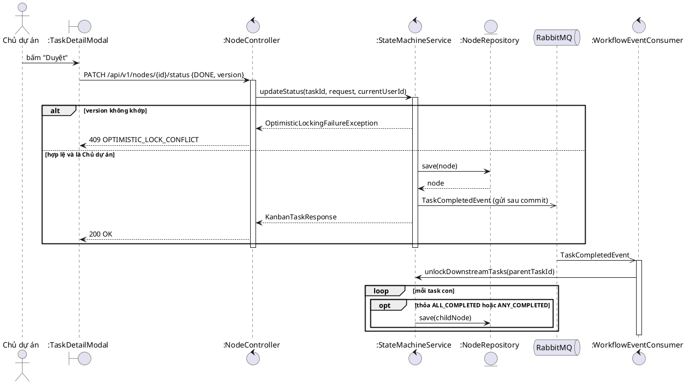

**Checklist (9 mục)**
- [ ] Lifeline là đối tượng (`:Lớp`), lớp có thật trong code (sơ đồ thiết kế).
- [ ] Mỗi message là một phương thức có trong class diagram của lớp nhận.
- [ ] Lời gọi đồng bộ có message trả về (khi có giá trị trả về).
- [ ] Message bất đồng bộ (RabbitMQ, SSE) dùng đầu mũi tên hở.
- [ ] `alt` và `opt` có điều kiện; `alt` có đủ các nhánh.
- [ ] `loop` ghi rõ lặp theo cái gì.
- [ ] Thanh kích hoạt hợp lý (không bị bật mãi).
- [ ] Bắt đầu từ actor hoặc boundary; khớp với một use case cụ thể.
- [ ] Không có chi tiết vụn (log, getter, setter).

### 3.5 Communication

**Dùng khi:** muốn nhấn mạnh **đối tượng nào liên kết với đối tượng nào**. Sequence thì nhấn mạnh thứ tự thời gian. Hai loại chuyển qua lại cho nhau được.

**Ký hiệu:** hộp đối tượng; đường liên kết; message đánh số theo cấp (1, 1.1, 1.2, 2…) kèm mũi tên nhỏ chỉ chiều.

**Ví dụ (vẽ gần đúng bằng object diagram trong PlantUML)**
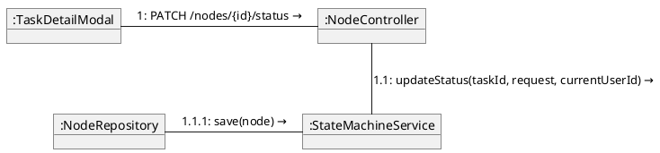

**Checklist (5 mục)**
- [ ] Số thứ tự message thể hiện đúng cấp lồng nhau (1 → 1.1 → 1.1.1).
- [ ] Mỗi message nằm trên đúng đường liên kết giữa 2 đối tượng gọi nhau.
- [ ] Có mũi tên chỉ chiều của từng message.
- [ ] Nội dung khớp 100% với sequence tương ứng.
- [ ] Đối tượng ghi dạng `:Lớp`.

### 3.6 Class

#### 3.6a Class phân tích (BCE)
- **Boundary**: lớp giao tiếp với actor (màn hình, API).
- **Control**: lớp điều phối một use case.
- **Entity**: dữ liệu nghiệp vụ tồn tại lâu dài.
- Quy tắc gọi: actor chỉ làm việc với boundary; boundary gọi control; control làm việc với entity; entity không gọi boundary.

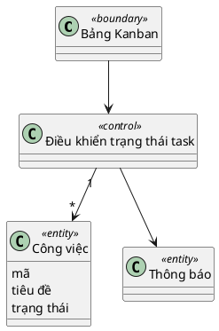

#### 3.6b Class thiết kế
**Ký hiệu phải nhớ**
- Hộp lớp có 3 ngăn: tên, thuộc tính, phương thức.
- Visibility: `+` public, `-` private, `#` protected, `~` package.
- Thuộc tính `tên : Kiểu`; phương thức `tên(thamSố : Kiểu) : KiểuTrảVề`.
- `<<interface>>`, `<<enumeration>>`, `{abstract}`, `{static}` (gạch chân).
- Quan hệ:
  - **Association** (nét liền, có thể có mũi tên điều hướng), ghi bội số `1`, `0..1`, `*`, `1..*`.
  - **Aggregation** (đầu thoi rỗng): quan hệ "có", phần tồn tại độc lập với toàn thể.
  - **Composition** (đầu thoi đặc): phần sống chết cùng toàn thể. Ví dụ: xóa Dự án thì Giai đoạn bị xóa theo (`ON DELETE CASCADE`).
  - **Generalization** (nét liền, tam giác rỗng): kế thừa lớp. Ví dụ `AccessDeniedException` → `ForbiddenException` → `RuntimeException`.
  - **Realization** (nét đứt, tam giác rỗng): cài đặt interface. Ví dụ `AiServiceClientImpl` cài đặt `AiServiceClient`.
  - **Dependency** (nét đứt, mũi tên hở): dùng tạm. Ví dụ controller dùng service.
  - **Lớp kết hợp** (association class): `ProjectMemberEntity` nối Người dùng với Dự án; `NodeDependencyEntity` nối Node với Node.

**Lưu ý riêng cho dự án này:** entity JPA trong code lưu khóa ngoại dạng `projectId : Long`, không dùng `@ManyToOne`. Vì vậy:
- Class diagram **miền** (X3): vẽ quan hệ association kèm bội số, **không** ghi `projectId` thành thuộc tính.
- Class diagram **thiết kế** (A8–D8, sát code): có thể ghi `projectId : Long`, khi đó thêm note "tham chiếu bằng id" và **không** vẽ thêm association trùng.
- Chọn một cách cho mỗi sơ đồ và giữ nhất quán.

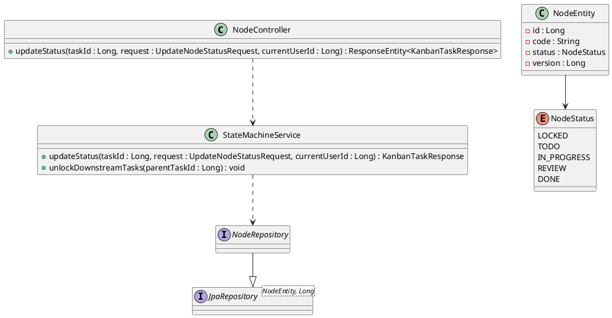

**Lỗi hay bị trừ điểm:** nhầm aggregation với composition; thiếu bội số; vẽ trùng (vừa có thuộc tính khóa ngoại vừa có association); mũi tên kế thừa vẽ ngược; liệt kê hết getter/setter do Lombok sinh ra (không cần); trộn lớp phân tích với lớp thiết kế trong cùng một sơ đồ.

**Checklist (9 mục)**
- [ ] Tên lớp khớp code (sơ đồ thiết kế) hoặc khớp nghiệp vụ (sơ đồ phân tích).
- [ ] Thuộc tính và phương thức có visibility và kiểu (sơ đồ thiết kế).
- [ ] Mọi association có bội số ở cả 2 đầu.
- [ ] Phân biệt đúng aggregation và composition, có lý do.
- [ ] Generalization và realization đúng ký hiệu, đúng chiều.
- [ ] Dependency dùng cho quan hệ "dùng tạm" (controller → service).
- [ ] Không vẽ trùng thuộc tính khóa ngoại và association.
- [ ] Không liệt kê getter/setter.
- [ ] Phương thức xuất hiện trong sequence đều có trong lớp tương ứng.

### 3.7 State machine

**Dùng khi:** một đối tượng có vòng đời rõ ràng. Trong dự án có: Task (C), Lời mời và Góp ý (D), Dự án (B), Tài khoản và Refresh token (A).

**Ký hiệu phải nhớ**
- Trạng thái: hình chữ nhật bo tròn, tên là danh từ hoặc tính từ ("Đang chờ duyệt", `REVIEW`).
- Trạng thái đầu (chấm đen), trạng thái kết thúc (chấm đen trong vòng tròn).
- Chuyển trạng thái ghi dạng `sự kiện [điều kiện] / hành động`.
- Tự chuyển (mũi tên quay về chính nó), trạng thái lồng (composite), điểm lựa chọn (choice, hình thoi).

**Lỗi hay bị trừ điểm:** đặt tên trạng thái bằng hành động ("Duyệt bài"); chuyển trạng thái thiếu sự kiện; các điều kiện không loại trừ nhau; nhầm với activity; trạng thái không khớp enum trong code.

**Ví dụ: vòng đời Task**
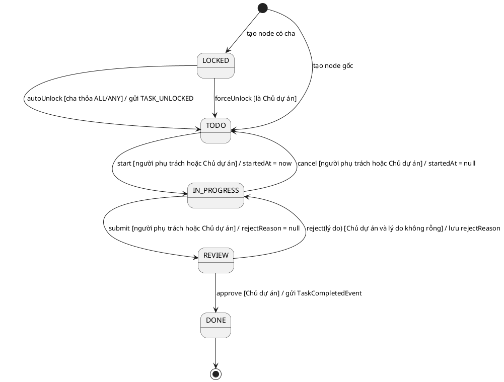

**Checklist (8 mục)**
- [ ] Có trạng thái đầu; có trạng thái kết thúc nếu đối tượng có điểm dừng.
- [ ] Tên trạng thái là danh từ hoặc tính từ, khớp enum trong code.
- [ ] Mọi chuyển trạng thái có sự kiện.
- [ ] Điều kiện `[ ]` đúng nghiệp vụ, các điều kiện loại trừ nhau.
- [ ] Hành động `/ …` ghi những thay đổi quan trọng (lưu lý do, gửi sự kiện).
- [ ] Không có chuyển trạng thái nào trái đặc tả (ví dụ TODO → DONE).
- [ ] Mỗi chuyển ứng với đúng một nhánh code, và ngược lại.
- [ ] Không lẫn hành động vào thành trạng thái.

### 3.8 Component

**Dùng khi:** chia hệ thống thành các khối phần mềm và chỉ ra khối nào cung cấp hay cần interface gì.

**Ký hiệu:** component (hình chữ nhật có biểu tượng component); interface cung cấp (hình kẹo mút ○); interface yêu cầu (hình ổ cắm ⊂); dependency; port (tùy chọn).

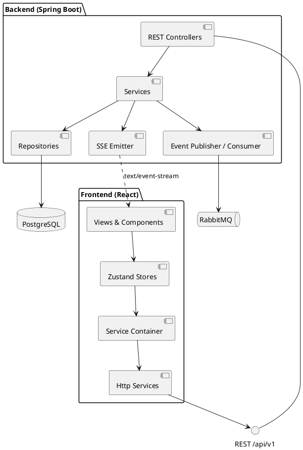

**Checklist (5 mục)**
- [ ] Mỗi component là một khối có trách nhiệm rõ ràng.
- [ ] Interface giữa FE và BE được vẽ rõ (REST, SSE).
- [ ] Có PostgreSQL và RabbitMQ, chiều phụ thuộc đúng.
- [ ] Không vẽ từng lớp nhỏ (đó là việc của class diagram).
- [ ] Khớp kiến trúc trong `docs/specs/backend-architecture.md` và integration map Chương I.

### 3.9 Deployment

**Dùng khi:** chỉ ra phần mềm chạy trên máy nào, môi trường nào, nối nhau bằng giao thức gì.

**Ký hiệu:** node (khối hộp 3D) với `<<device>>` hoặc `<<executionEnvironment>>`; artifact (file có góc gập: `.jar`, thư mục `dist/`); đường nối có ghi giao thức và cổng.

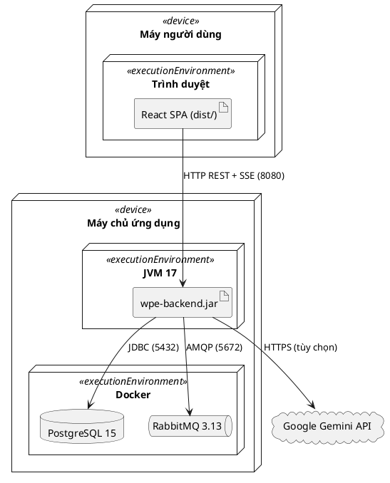

**Checklist (5 mục)**
- [ ] Phân biệt node thiết bị và node môi trường chạy.
- [ ] Artifact đặt đúng node.
- [ ] Đường nối có giao thức và cổng, khớp `wpe-backend/docker-compose.yml` và `application.yml`.
- [ ] Có dịch vụ bên ngoài (Gemini) nếu dùng.
- [ ] Ghi rõ đang vẽ môi trường dev hay môi trường triển khai (dev có thêm Vite cổng 5173).

### 3.10 Package

**Dùng khi:** chỉ ra cách chia gói của code và chiều phụ thuộc giữa các gói. Không được có phụ thuộc vòng.

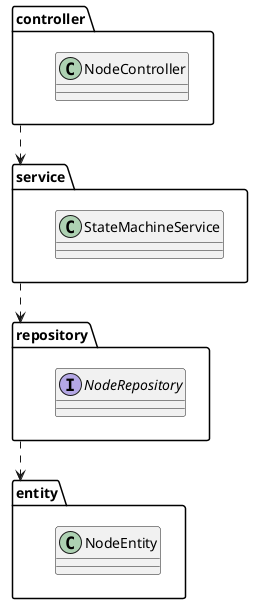

**Checklist (4 mục)**
- [ ] Tên gói khớp thư mục trong `wpe-backend/src/main/java/com/pipeline/wpe/`.
- [ ] Chiều phụ thuộc đi từ tầng trên xuống tầng dưới.
- [ ] Không có phụ thuộc vòng.
- [ ] Có các gói phụ: `dto`, `mapper`, `config`, `security`, `exception`.

### 3.11 Object

**Dùng khi:** chụp lại các đối tượng cụ thể và giá trị của chúng **tại một thời điểm**. Rất hợp để giải thích thuật toán, ví dụ in-degree trước và sau một bước Kahn.

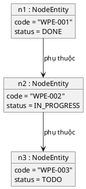

**Checklist (4 mục)**
- [ ] Tên đối tượng dạng `tên : Lớp`.
- [ ] Giá trị thuộc tính là giá trị cụ thể, lấy từ dữ liệu thật (seed).
- [ ] Liên kết khớp quan hệ trong class diagram.
- [ ] Ghi rõ thời điểm chụp (ví dụ "trước khi chạy Kahn").

### 3.12 ERD (sơ đồ cơ sở dữ liệu)

ERD hiện có trong `docs/specs/database-schema.md` (Mermaid). X3 cập nhật sau các migration V5, V6, V7.

**Ký hiệu chân chim (crow's foot):** `||` đúng một, `o|` không hoặc một, `|{` một hoặc nhiều, `o{` không hoặc nhiều. Ghi rõ PK và FK. Quan hệ nhiều-nhiều phải đi qua bảng trung gian.

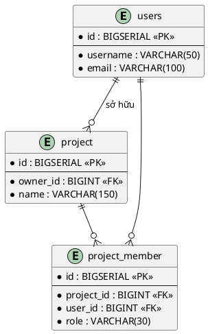

**ERD khác class diagram ở đâu:** ERD mô tả **bảng và cột** (có kiểu SQL, có khóa ngoại); class diagram mô tả **lớp và hành vi** (có phương thức, kế thừa, interface).

**Checklist (5 mục)**
- [ ] Đủ mọi bảng trong migration (V1 đến bản mới nhất).
- [ ] PK, FK ghi đúng; ký hiệu bội số đúng theo ràng buộc `NOT NULL` và `UNIQUE`.
- [ ] Quan hệ nhiều-nhiều đi qua bảng trung gian (`project_member`, `node_dependency`, `phase_dependency`).
- [ ] Tên cột khớp file SQL.
- [ ] Có ghi chú các ràng buộc quan trọng (unique, check, partial index).

### 3.13 BFD (sơ đồ phân rã chức năng — chỉ khi GV yêu cầu)

Cây chức năng từ tổng quát xuống chi tiết, không có luồng dữ liệu. Bản cũ ở `docs/archive/docs_for_db_bfd/bfd.md` (không sửa file archive, vẽ bản mới ở `docs/ooad/he-thong/`).

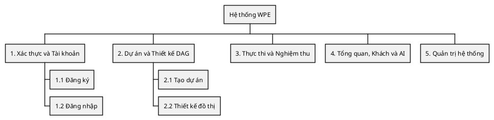

---

## 4. Ma trận nhất quán giữa các sơ đồ

Giảng viên rất hay hỏi kiểu: "Message này trong sequence nằm ở đâu trong class diagram?", "Trạng thái này có trong code không?". Bảng dưới là những cặp **bắt buộc phải khớp**:

| Phần tử | Phải khớp với | Cách kiểm |
| :--- | :--- | :--- |
| Use case trong sơ đồ | Ma trận RBAC, `docs/specs/system-overview.md` mục 4 | So tên và mã UC |
| Luồng ngoại lệ trong đặc tả | Mã lỗi trong code, integration map Chương III | Tra mã lỗi bằng `grep` |
| Hành động trong activity | Luồng chính và luồng thay thế của đặc tả | Mỗi hành động có trong đặc tả |
| Message trong sequence thiết kế | Phương thức trong class diagram thiết kế | Mỗi message là một phương thức của lớp nhận |
| Class diagram thiết kế | Code | Tên lớp, phương thức, kiểu (`grep`) |
| Sơ đồ state | Enum trong code (`NodeStatus`, `InvitationStatus`, `ProjectStatus`, `FeedbackStatus`) | Đủ giá trị, đúng tên |
| Class miền | ERD và entity | Mỗi entity là một bảng, quan hệ khớp khóa ngoại |
| Component, deployment | `docker-compose.yml`, `application.yml` | Đúng dịch vụ, đúng cổng |
| Tên use case (sơ đồ tổng ↔ sơ đồ mảng) | Nhau | Trùng tên tuyệt đối |

**Mẫu file `nhat-quan.md`** (dùng ở A8–D8):

| Sơ đồ | Phần tử | Lớp.phương thức / enum | `file:dòng` | Khớp? |
| :--- | :--- | :--- | :--- | :--- |
| seq-duyet-task | message 2 | `StateMachineService.updateStatus` | `…/StateMachineService.java:98` | ✔ |

---

## 5. Mẫu thiết kế và nguyên lý OOP có trong dự án

Các vị trí dưới đây đã được đối chiếu với code ngày 11/11/2026. Code thay đổi thì cập nhật lại bảng.

| Mẫu / nguyên lý | Ở đâu trong dự án | Ý nghĩa |
| :--- | :--- | :--- |
| Kiến trúc phân lớp | `controller` → `service` → `repository` → `entity` trong `wpe-backend/src/main/java/com/pipeline/wpe/` | Mỗi tầng một trách nhiệm, tầng trên chỉ gọi tầng dưới |
| Repository | 13 interface trong `repository/` đều kế thừa `JpaRepository` | Tách truy cập dữ liệu khỏi nghiệp vụ |
| DTO | Các `record` trong `dto/`, ví dụ `KanbanTaskResponse` | Không đưa entity ra ngoài controller |
| Mapper | `mapper/NodeMapper.java` (MapStruct `@Mapper`) | Chuyển entity sang DTO một chỗ |
| Dependency Injection | Spring `@RequiredArgsConstructor` (inject qua constructor); FE `wpe-frontend/src/services/container.ts` | Lớp không tự `new` thứ nó phụ thuộc |
| Strategy / plug-in | `AiServiceClient` (interface) + `AiServiceClientImpl`; FE `IWorkflowService` với bản Mock và bản Http | Đổi cách làm mà không sửa nơi gọi |
| Observer / Publish–Subscribe | `WorkflowEventPublisher` → RabbitMQ → `WorkflowEventConsumer`; `SseEmitterService` → `EventSource` trên trình duyệt | Bên phát không cần biết ai nghe |
| Builder | `@Builder` (Lombok) trên các entity | Tạo đối tượng nhiều trường cho dễ đọc |
| Singleton | Bean Spring mặc định là singleton | Mỗi service chỉ có 1 thể hiện |
| Máy trạng thái | `StateMachineService.updateStatus`; FE `wpe-frontend/src/domain/taskTransitions.ts` | Hiện viết bằng if/else. Có thể nâng lên mẫu State hoặc bảng chuyển trạng thái |
| Kế thừa | `AccessDeniedException` → `ForbiddenException` → `RuntimeException` | Generalization trong class diagram |
| Đóng gói | Thuộc tính entity là `private`, truy cập qua getter/setter | |
| Optimistic locking | `@Version` trong `NodeEntity` và `ProjectInvitationEntity` | Chặn ghi đè khi 2 người sửa cùng lúc (409) |
| Composition thay cho kế thừa | Task A2 đổi `HttpWorkflowService` từ kế thừa `MockWorkflowService` sang giữ một instance mock | "Có một" thay vì "là một" |

**SOLID trong dự án**
- **S** (một trách nhiệm): mỗi service lo một mảng (`ProjectInvitationService`, `FeedbackQueueService`…).
- **O** (mở để mở rộng, đóng để sửa): thêm một cài đặt `AiServiceClient` mới mà không sửa `AiDiagnosticService`.
- **L** (thay thế Liskov): bản Mock và bản Http của `IWorkflowService` thay cho nhau được, component không biết khác biệt.
- **I** (tách interface): FE tách `IGuestService`, `IProfileService`, `INotificationService`… thay vì một interface khổng lồ.
- **D** (đảo phụ thuộc): component phụ thuộc interface qua `container.ts`; service phụ thuộc interface repository.

---

## 6. Ngân hàng câu hỏi vấn đáp

Dùng cho X4. Trả lời phải kèm **ví dụ trong dự án**.

**UML chung**
1. UML là gì? Có mấy nhóm sơ đồ (cấu trúc và hành vi)? Kể tên các sơ đồ nhóm mình đã vẽ theo từng nhóm.
2. Phân tích khác thiết kế ở đâu? Sơ đồ nào thuộc giai đoạn nào?

**Use case**
3. include khác extend ở đâu? Lấy ví dụ trong dự án.
4. Khi nào dùng tổng quát hóa giữa actor? Ví dụ trong dự án.
5. Actor có thể là một hệ thống hoặc thời gian không? Ví dụ.
6. Vì sao không vẽ "Đăng nhập" thành include của mọi use case?
7. Tiền điều kiện khác luồng ngoại lệ ở đâu?

**Activity**
8. Activity khác state machine ở đâu?
9. Fork/join khác decision/merge ở đâu?
10. Swimlane dùng để làm gì?

**Sequence, communication**
11. Sequence khác communication ở đâu? Khi nào dùng loại nào?
12. Message đồng bộ khác bất đồng bộ thế nào? Ví dụ trong dự án.
13. `alt`, `opt`, `loop`, `par` khác nhau thế nào?

**Class**
14. BCE là gì? Các loại lớp được gọi nhau theo quy tắc nào?
15. Lớp phân tích khác lớp thiết kế ở đâu?
16. Aggregation khác composition? Ví dụ trong dự án.
17. Association khác dependency?
18. Generalization khác realization? Chỉ ví dụ trong code.
19. Bội số `0..1`, `1..*`, `*` nghĩa là gì? Bội số giữa Dự án và Thành viên là bao nhiêu?
20. Lớp kết hợp (association class) là gì? Ví dụ trong dự án.
21. Class diagram khác ERD ở đâu?

**State**
22. Sự kiện, điều kiện, hành động trên một chuyển trạng thái là gì? Lấy ví dụ từ sơ đồ task.

**Kiến trúc**
23. Component diagram khác deployment diagram ở đâu?

**OOP và mẫu thiết kế**
24. 4 tính chất của OOP là gì? Chỉ ví dụ trong code.
25. Chọn 2 nguyên tắc SOLID, chỉ chỗ áp dụng trong dự án.
26. Strategy, Observer, Repository nằm ở đâu trong dự án?

**Về dự án**
27. Vì sao dự án dùng DAG? Thuật toán Kahn chạy thế nào?
28. Optimistic locking là gì? Khi nào hệ thống trả 409?
29. Vì sao mở khóa task con đi qua RabbitMQ thay vì làm luôn trong request?
30. Vì sao không trả thẳng JPA entity ra controller?
