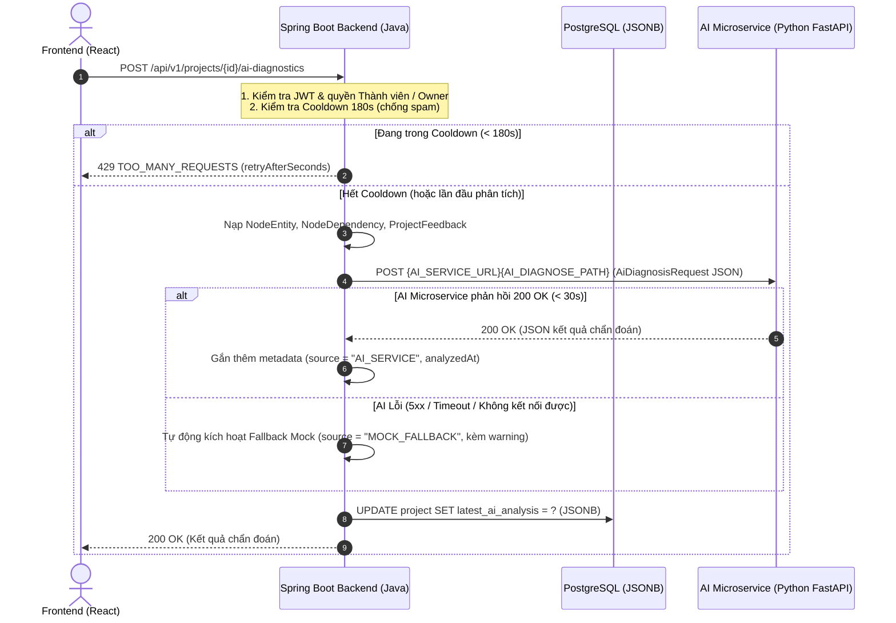

# Hợp Đồng Giao Tiếp HTTP Giữa Backend (Java) & AI Microservice (Python)

> **Tài liệu**: Hợp đồng dịch vụ API (API Service Contract SSOT)  
> **Dự án**: Workflow-Pipeline-Engine  
> **Bên gọi (Consumer)**: Spring Boot 3 Backend (`HttpAiServiceClient`)  
> **Bên cung cấp (Provider)**: Python AI Microservice (FastAPI + Google Gemini API)  

---

## 1. Sơ Đồ Luồng Hoạt Động (Architecture Flow)

Khi người dùng thao tác bấm nút "AI Diagnosis" trên giao diện Frontend:



---

## 2. Cấu Hình Môi Trường & Cơ Chế Kích Hoạt

Backend Java hỗ trợ chuyển đổi linh hoạt giữa dữ liệu giả lập (Mock) và gọi sang AI Microservice thông qua các biến môi trường cấu hình tại `application.yml`:

| Biến môi trường | Thuộc tính YAML tương ứng | Mặc định | Mô tả |
| :--- | :--- | :--- | :--- |
| `AI_MODE` | `app.ai.mode` | `mock` | `mock`: Dùng dữ liệu phân tích giả lập nội bộ trong Java.<br/>`http`: Kích hoạt `HttpAiServiceClient` gọi sang Python microservice. |
| `AI_SERVICE_URL` | `app.ai.service-url` | `http://localhost:8081` | Địa chỉ gốc (Base URL) của AI Microservice. |
| `AI_DIAGNOSE_PATH` | `app.ai.diagnose-path` | `/api/ai/diagnose` | Đường dẫn endpoint API chẩn đoán của microservice. |
| `AI_CONNECT_TIMEOUT_SECONDS` | `app.ai.connect-timeout-seconds` | `3` | Thời gian tối đa thiết lập kết nối TCP (giây). |
| `AI_READ_TIMEOUT_SECONDS` | `app.ai.read-timeout-seconds` | `30` | Thời gian tối đa chờ microservice xử lý và trả dữ liệu (giây). |

> **Lưu ý**: Mặc định `AI_MODE=mock`, do đó khi chạy Backend độc lập mà chưa khởi động microservice Python thì toàn bộ hệ thống vẫn chạy bình thường không bị lỗi.

---

## 3. Đặc Tả Yêu Cầu Đầu Vào (Request Specification)

- **Method**: `POST`
- **Path**: `/api/ai/diagnose` (hoặc cấu hình qua `AI_DIAGNOSE_PATH`)
- **Headers**:
  - `Content-Type: application/json`
  - `Accept: application/json`
- Backend gửi kèm Content-Length.

### 3.1 Cấu Trúc Các Trường Dữ Liệu (`AiDiagnosisRequest`)

| Trường | Kiểu dữ liệu | Bắt buộc | Mô tả |
| :--- | :--- | :---: | :--- |
| `projectId` | Long | Có | ID định danh của dự án trong Database. |
| `projectName` | String | Có | Tên dự án. |
| `projectStatus` | String | Có | Trạng thái dự án: `DRAFT`, `ACTIVE`, `COMPLETED`, `ARCHIVED`. |
| `requestedAt` | String (ISO-8601) | Có | Thời điểm gửi yêu cầu (UTC), ví dụ: `2026-11-12T09:44:11.123Z`. |
| `nodes` | Array[NodeDto] | Có | Danh sách các tác vụ/node hiện có trong đồ thị dự án. |
| `dependencies` | Array[DependencyDto] | Có | Danh sách các cung phụ thuộc giữa các node trong đồ thị DAG. |
| `openFeedbacks` | Array[FeedbackDto] | Có | Danh sách các ý kiến đóng góp chưa giải quyết (`OPEN`). |

#### Chi tiết `NodeDto`:
- `id` (Long): ID duy nhất của node.
- `code` (String): Mã node duy nhất trong dự án (ví dụ: `WPE-001`).
- `title` (String): Tên/tiêu đề tác vụ.
- `status` (String): Trạng thái node (`LOCKED`, `TODO`, `IN_PROGRESS`, `REVIEW`, `DONE`).
- `phaseId` (Long): ID giai đoạn chứa node (có thể null).
- `estimatedHours` (Integer): Ước tính giờ hoàn thành.
- `startedAt` (String ISO-8601): Thời điểm bắt đầu thực hiện (hoặc null nếu chưa làm).
- `dueDate` (String ISO-8601): Hạn chót hoàn thành (hoặc null).
- `isOverdue` (Boolean): Đánh dấu tác vụ đã quá hạn chót hay chưa.
- `assignedUserId` (Long): ID thành viên được phân công (hoặc null nếu chưa gán).
- `joinPolicy` (String): Chính sách mở khóa (`ALL_COMPLETED` - AND join, hoặc `ANY_COMPLETED` - OR join).

#### Chi tiết `DependencyDto`:
- `parentNodeId` (Long): ID của node cha (tiền điều kiện).
- `childNodeId` (Long): ID của node con (bị khóa hoặc kích hoạt khi cha xong).

#### Chi tiết `FeedbackDto`:
- `id` (Long): ID của bản ghi feedback.
- `nodeId` (Long): ID của node được gắn kèm góp ý (hoặc null nếu góp ý chung toàn dự án).
- `reviewerRole` (String): Vai trò người góp ý (`TEACHER` hoặc `GUEST`).
- `content` (String): Nội dung phản hồi, nhận xét.
- `createdAt` (String ISO-8601): Thời điểm gửi nhận xét.

### 3.2 Ví Dụ JSON Request Hoàn Chỉnh (2 Node, 1 Cạnh Phụ Thuộc, 1 Góp Ý)

```json
{
  "projectId": 10,
  "projectName": "Xây dựng cổng thanh toán trực tuyến",
  "projectStatus": "ACTIVE",
  "requestedAt": "2026-11-12T09:44:11.123Z",
  "nodes": [
    {
      "id": 101,
      "code": "WPE-001",
      "title": "Thiết kế CSDL 3NF & API Contract",
      "status": "DONE",
      "phaseId": 1,
      "estimatedHours": 16,
      "startedAt": "2026-11-01T08:00:00Z",
      "dueDate": "2026-11-03T17:00:00Z",
      "isOverdue": false,
      "assignedUserId": 2,
      "joinPolicy": "ALL_COMPLETED"
    },
    {
      "id": 102,
      "code": "WPE-002",
      "title": "Tích hợp cổng thanh toán VNPay",
      "status": "IN_PROGRESS",
      "phaseId": 2,
      "estimatedHours": 24,
      "startedAt": "2026-11-04T08:00:00Z",
      "dueDate": "2026-11-08T17:00:00Z",
      "isOverdue": true,
      "assignedUserId": 3,
      "joinPolicy": "ALL_COMPLETED"
    }
  ],
  "dependencies": [
    {
      "parentNodeId": 101,
      "childNodeId": 102
    }
  ],
  "openFeedbacks": [
    {
      "id": 501,
      "nodeId": 102,
      "reviewerRole": "TEACHER",
      "content": "Cần kiểm tra kỹ luồng IPN và checksum HMAC-SHA512 khi nhận webhook từ cổng.",
      "createdAt": "2026-11-09T10:15:00Z"
    }
  ]
}
```

---

## 4. Đặc Tả Dữ Liệu Phản Hồi Bắt Buộc (Response Specification)

Microservice Python cần trả về HTTP status `200 OK` kèm JSON Object chứa đầy đủ các khóa sau (đây là các khóa Frontend React và Backend Java đang phụ thuộc):

### 4.1 Danh Sách Các Khóa Bắt Buộc

1. **`analyzedAt`** (String, ISO-8601): Thời điểm kết thúc phân tích (UTC). Nếu microservice không trả, Java sẽ tự điền thời điểm hiện tại.
2. **`source`** (String, tùy chọn): Đặt `"AI_SERVICE"`. Nếu bỏ trống, Java sẽ tự điền `"AI_SERVICE"`.
3. **`criticalPath`** (Array[String]): Mảng các mã node (`code`) nằm trên đường găng CPM dài nhất của dự án (ví dụ: `["WPE-001", "WPE-002"]`).
4. **`bottlenecks`** (Array[Object]): Danh sách các điểm nghẽn tiến độ.
   - `nodeCode` (String): Mã node.
   - `title` (String): Tiêu đề node.
   - `reason` (String): Lý do gây nghẽn.
   - `severity` (String): Mức độ nghiêm trọng (`HIGH`, `MEDIUM`, `LOW`).
5. **`taskTraps`** (Array[Object]): Cảnh báo bẫy tác vụ (nguy cơ treo hoặc phụ thuộc chéo).
   - `nodeCode` (String): Mã node.
   - `title` (String): Tiêu đề node.
   - `trapType` (String): Loại bẫy (ví dụ: `POTENTIAL_STALL`, `MISSING_DEPENDENCY`).
   - `suggestion` (String): Gợi ý gỡ bẫy.
6. **`actionableAdvice`** (Array[Object]): Đề xuất hành động tức thì cho Chủ dự án.
   - `action` (String): Loại hành động (ví dụ: `SPLIT_NODE`, `RESOLVE_FEEDBACK`, `CONTINUE_PIPELINE`).
   - `targetNodeCode` (String): Mã node cần can thiệp, hoặc `"GENERAL"` nếu áp dụng toàn dự án.
   - `instruction` (String): Hướng dẫn chi tiết hành động.
   - `priority` (String): Mức ưu tiên (`HIGH`, `MEDIUM`, `LOW`).
7. **`metrics`** (Object): Các chỉ số quỹ đạo tiến độ.
   - `targetVelocity` (Number): Vận tốc mục tiêu (số task/tuần).
   - `actualVelocity` (Number): Vận tốc thực tế hiện tại.
   - `driftScore` (Number): Điểm số lệch quỹ đạo (0.0 - 100.0).
   - `status` (String): Đánh giá tổng thể (`STABLE_GREEN`, `RED_ALERT`, `YELLOW_WARNING`).

> **Khóa bổ sung**: Microservice có thể trả thêm các khóa mở rộng khác tùy nhu cầu (ví dụ: `geminiModelVersion`, `reasoningNotes`). Backend Java lưu toàn bộ Object vào cột JSONB `latest_ai_analysis` mà không cắt tỉa.

### 4.2 Ví Dụ JSON Response Mẫu

```json
{
  "analyzedAt": "2026-11-12T09:44:15.000Z",
  "source": "AI_SERVICE",
  "criticalPath": [
    "WPE-001",
    "WPE-002"
  ],
  "bottlenecks": [
    {
      "nodeCode": "WPE-002",
      "title": "Tích hợp cổng thanh toán VNPay",
      "reason": "Tác vụ đã vượt quá hạn chót (due_date) 4 ngày và đang giữ chân downstream nodes.",
      "severity": "HIGH"
    }
  ],
  "taskTraps": [
    {
      "nodeCode": "WPE-002",
      "title": "Tích hợp cổng thanh toán VNPay",
      "trapType": "POTENTIAL_STALL",
      "suggestion": "Nên phân rã nhỏ phạm vi công việc hoặc bổ sung người phối hợp pair-programming."
    }
  ],
  "actionableAdvice": [
    {
      "action": "SPLIT_NODE",
      "targetNodeCode": "WPE-002",
      "instruction": "Tách tác vụ WPE-002 thành: (1) Tích hợp Sandbox API và (2) Xử lý Webhook IPN.",
      "priority": "HIGH"
    },
    {
      "action": "RESOLVE_FEEDBACK",
      "targetNodeCode": "WPE-002",
      "instruction": "Kiểm tra và xử lý góp ý của Giáo viên về luồng checksum HMAC-SHA512.",
      "priority": "HIGH"
    }
  ],
  "metrics": {
    "targetVelocity": 2.0,
    "actualVelocity": 1.2,
    "driftScore": 42.5,
    "status": "RED_ALERT"
  }
}
```

---

## 5. Cơ Chế Xử Lý Lỗi & Dự Phòng (Error Handling & Fallback)

Hệ thống Java được trang bị cơ chế tự phục hồi chống gián đoạn (Fault Tolerance):

1. **Điều kiện kích hoạt Fallback**:
   - Microservice trả HTTP Status khác 2xx (ví dụ: 400, 500, 502, 503).
   - Quá thời gian chờ (Timeout): Thiết lập kết nối vượt quá `3s`, hoặc xử lý vượt quá `30s`.
   - Lỗi mạng: Không tìm thấy host, từ chối kết nối (`Connection refused`).
   - Phản hồi có body rỗng (`null`).
2. **Hành vi Fallback của Java**:
   - Không ném Exception ra ngoài Controller, không làm crash giao diện người dùng.
   - Ghi `log.warn(...)` kèm nguyên nhân ngắn gọn.
   - Lập tức chuyển sang bộ phân tích giả lập nội bộ (`AiServiceClientImpl`), gắn thêm:
     - `"source": "MOCK_FALLBACK"`
     - `"warning": "Không gọi được dịch vụ AI ({lý do ngắn}), đang hiển thị dữ liệu giả."`
3. **Khuyến nghị cho Microservice**:
   - Microservice nên hoàn tất việc suy luận và trả phản hồi trong vòng **< 15–20 giây** để tránh tiệm cận ngưỡng `read-timeout-seconds: 30`.
   - Nếu gọi Google Gemini API bị lỗi hoặc quá hạn ngạch (Rate Limit 429), microservice nên tự bắt lỗi và trả về phản hồi fallback nhanh gọn thay vì để kết nối bị treo.

---

## 6. Server Python Mẫu (FastAPI ~25 Dòng)

Dưới đây là mã nguồn Python FastAPI tối thiểu, chuẩn hợp đồng, có thể chạy ngay để tích hợp thử nghiệm:

### Cài đặt thư viện:
```bash
pip install fastapi uvicorn
```

### File `main.py`:
```python
from fastapi import FastAPI
from datetime import datetime, timezone
from typing import Dict, Any
import uvicorn

app = FastAPI(title="WPE AI Microservice", version="1.0.0")

@app.post("/api/ai/diagnose")
def diagnose_pipeline(payload: Dict[str, Any]):
    nodes = payload.get("nodes", [])
    node_codes = [n.get("code") for n in nodes if n.get("code")]
    first_code = node_codes[0] if node_codes else "WPE-001"

    return {
        "analyzedAt": datetime.now(timezone.utc).isoformat(),
        "source": "AI_SERVICE",
        "criticalPath": node_codes if node_codes else ["WPE-001"],
        "bottlenecks": [
            {
                "nodeCode": first_code,
                "title": "Tác vụ khởi đầu",
                "reason": "Tiến độ đang trong tầm kiểm soát ổn định (DriftScore < 20%).",
                "severity": "LOW"
            }
        ],
        "taskTraps": [],
        "actionableAdvice": [
            {
                "action": "CONTINUE_PIPELINE",
                "targetNodeCode": "GENERAL",
                "instruction": "Duy trì nhịp độ thực hiện tác vụ theo đúng đường găng CPM.",
                "priority": "LOW"
            }
        ],
        "metrics": {
            "targetVelocity": 2.0,
            "actualVelocity": 1.8,
            "driftScore": 15.0,
            "status": "STABLE_GREEN"
        }
    }

if __name__ == "__main__":
    uvicorn.run("main:app", host="0.0.0.0", port=8081, reload=True)
```

### Chạy microservice:
```bash
uvicorn main:app --port 8081
```

---

## 7. Hướng Dẫn Kiểm Thử Nhanh (Testing Guide)

### 7.1 Kiểm Thử Trực Tiếp Microservice Bằng `curl`
Gửi request kiểm tra xem microservice Python có phản hồi đúng schema không:

```bash
curl -X POST http://localhost:8081/api/ai/diagnose \
  -H "Content-Type: application/json" \
  -d '{
    "projectId": 1,
    "projectName": "Test Project",
    "projectStatus": "ACTIVE",
    "requestedAt": "2026-11-12T00:00:00Z",
    "nodes": [
      {"id": 1, "code": "WPE-001", "title": "Node 1", "status": "TODO", "phaseId": 1, "estimatedHours": 8, "startedAt": null, "dueDate": null, "isOverdue": false, "assignedUserId": null, "joinPolicy": "ALL_COMPLETED"}
    ],
    "dependencies": [],
    "openFeedbacks": []
  }'
```

### 7.2 Kiểm Thử Tích Hợp Qua Backend Spring Boot
1. Bật microservice Python trên cổng `8081`.
2. Khởi động Backend Java với chế độ HTTP:
   - Trên Linux/macOS:
     ```bash
     AI_MODE=http AI_SERVICE_URL=http://localhost:8081 ./mvnw spring-boot:run
     ```
   - Trên Windows PowerShell:
     ```powershell
     $env:AI_MODE="http"; $env:AI_SERVICE_URL="http://localhost:8081"; ./mvnw spring-boot:run
     ```
3. Gửi lệnh kích hoạt chẩn đoán từ Client/Swagger UI hoặc curl (kèm header `X-Debug-User-Id: 2` tương ứng với Project Owner):
   ```bash
   curl -X POST http://localhost:8080/api/v1/projects/1/ai-diagnostics \
     -H "X-Debug-User-Id: 2"
   ```
4. Kiểm tra trường `source` trong JSON trả về:
   - `AI_SERVICE`: Đã kết nối và lấy thành công từ microservice Python.
   - `MOCK_FALLBACK`: Microservice chưa bật hoặc bị timeout, hệ thống tự động trả fallback an toàn kèm cảnh báo.

---

## 8. Nguyên Tắc Bảo Mật & Quản Lý API Key

1. **Phân quyền tại Backend**: Backend Java đã kiểm tra toàn bộ quyền truy cập (chỉ thành viên dự án hoặc Owner mới được gọi phân tích). Microservice Python chỉ nhận dữ liệu đã được Backend thẩm định.
2. **Không gửi dữ liệu nhạy cảm**: Backend **KHÔNG** gửi mật khẩu, email cá nhân hay access token của người dùng sang microservice AI. Chỉ gửi ID ẩn danh (`assignedUserId`), mã tác vụ và nội dung mô tả công việc.
3. **Quản lý Gemini API Key**:
   - Backend Java tuyệt đối **KHÔNG** quản lý hay chứa Google Gemini API Key.
   - Gemini API Key được cấu hình riêng biệt tại biến môi trường của microservice Python (ví dụ: `GEMINI_API_KEY`).
