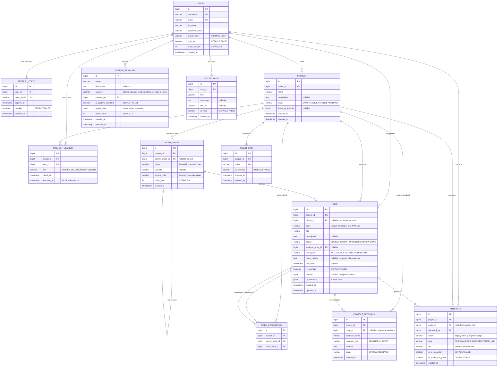

# Database Schema Specification (SSOT — 3NF & ERD)

> **Dự án**: Workflow-Pipeline-Engine  
> **Tài liệu**: Single Source of Truth (SSOT) — Đặc tả Cơ sở Dữ liệu 12 Bảng Chuẩn hóa 3NF  
> **Hệ quản trị CSDL mục tiêu**: PostgreSQL 15+ (Hỗ trợ kiểu JSONB & Timestamp with Time Zone)  
> **Ánh xạ tầng Backend**: Spring Boot 3 + Spring Data JPA (Hibernate 6)

---

## 1. Nguyên tắc Thiết kế & Chuẩn hóa (Database Principles)

1. **Chuẩn hóa 3NF (Third Normal Form)**:
   - Toàn bộ 12 bảng đều tuân thủ chuẩn 3NF, loại bỏ hoàn toàn dư thừa dữ liệu và các phụ thuộc bắc cầu (transitive dependencies).
   - Tối ưu hóa các bảng nối quan hệ (`PROJECT_MEMBER`, `NODE_DEPENDENCY`) với ràng buộc Unique Constraint.
2. **Quy ước Khóa chính (PK) & Khóa ngoại (FK)**:
   - Tất cả các trường định danh `id` đều sử dụng kiểu `bigint` tự tăng (Identity / Sequence), tương ứng kiểu `Long` trong Java.
   - Các khóa ngoại bắt buộc khai báo rõ ràng quy tắc toàn vẹn tham chiếu (Foreign Key Constraint).
3. **Quản lý Dữ liệu Động bằng JSONB**:
   - Sử dụng kiểu dữ liệu `jsonb` của PostgreSQL cho các cấu trúc dữ liệu bán cấu trúc:
     - `PROJECT.latest_ai_analysis`: Lưu bản ghi phân tích mới nhất của Gemini AI.
     - `PIPELINE_TEMPLATE.graph_data`: Lưu cấu trúc đồ thị mẫu 2 tầng.
     - `NODE.ui_metadata`: Lưu tọa độ vị trí (x, y, w, h) và màu sắc để vẽ canvas.
4. **Kiểm soát Xung đột Đồng thời (Optimistic Locking)**:
   - Entity trung tâm `NODE` sở hữu cột `version: bigint DEFAULT 0`, được ánh xạ với `@Version` của JPA để chống xung đột ghi đè khi nhiều người cập nhật đồng thời.
5. **Thời gian Chuẩn hóa**:
   - Tất cả các trường thời gian đều dùng kiểu `timestamp with time zone` (lưu trữ theo chuẩn ISO-8601 UTC).

---

## 2. Sơ đồ Thực thể Quan hệ (Mermaid ERD — 12 Bảng Chuẩn)

---

## 3. Đặc tả Chi tiết 12 Bảng (Data Dictionary)

### 3.1 Bảng `USERS` (Tài khoản Người dùng)
Quản lý danh tính, phân quyền hệ thống và phiên bảo mật của người dùng.

| Tên Cột | Kiểu Dữ Liệu | Ràng Buộc | Mặc Định | Ý Nghĩa Nghiệp Vụ |
| :--- | :--- | :--- | :--- | :--- |
| `id` | `bigint` | PK, Auto Increment | | Khóa chính định danh người dùng. |
| `username` | `varchar(50)` | UNIQUE, NOT NULL | | Tên đăng nhập duy nhất. |
| `email` | `varchar(100)` | UNIQUE, NOT NULL | | Email liên hệ và phục hồi tài khoản. |
| `full_name` | `varchar(100)` | NULLABLE | | Họ và tên đầy đủ hiển thị trên giao diện. |
| `password_hash` | `varchar(255)` | NOT NULL | | Mật khẩu băm an toàn bằng thuật toán BCrypt. |
| `system_role` | `varchar(20)` | NOT NULL | `'USER'` | Vai trò toàn hệ thống: `'ADMIN'`, `'USER'`. |
| `is_locked` | `boolean` | NOT NULL | `FALSE` | Cờ khóa tài khoản do Admin quản lý. |
| `token_version` | `int` | NOT NULL | `0` | Quản lý vô hiệu hóa phiên tức thời (khi đổi mật khẩu / khóa tài khoản). |
| `created_at` | `timestamptz` | NOT NULL | `NOW()` | Thời điểm tạo tài khoản. |

---

### 3.2 Bảng `REFRESH_TOKEN` (Phiên Làm việc & Xoay vòng Token)
Lưu trữ phiên đăng nhập phục vụ cơ chế Refresh Token Rotation.

| Tên Cột | Kiểu Dữ Liệu | Ràng Buộc | Mặc Định | Ý Nghĩa Nghiệp Vụ |
| :--- | :--- | :--- | :--- | :--- |
| `id` | `bigint` | PK, Auto Increment | | Khóa chính bản ghi phiên. |
| `user_id` | `bigint` | FK (USERS.id), NOT NULL | | Người dùng sở hữu phiên đăng nhập. |
| `token_hash` | `varchar(255)` | UNIQUE, NOT NULL | | Mã băm của Refresh Token. |
| `expires_at` | `timestamptz` | NOT NULL | | Thời điểm hết hạn phiên. |
| `revoked` | `boolean` | NOT NULL | `FALSE` | Cờ thu hồi phiên đăng nhập. |
| `created_at` | `timestamptz` | NOT NULL | `NOW()` | Thời điểm khởi tạo phiên. |

---

### 3.3 Bảng `PROJECT` (Dự án & Không gian Làm việc)
Quản lý thông tin chung, trạng thái dự án và lưu đệm chẩn đoán AI mới nhất.

| Tên Cột | Kiểu Dữ Liệu | Ràng Buộc | Mặc Định | Ý Nghĩa Nghiệp Vụ |
| :--- | :--- | :--- | :--- | :--- |
| `id` | `bigint` | PK, Auto Increment | | Khóa chính định danh dự án. |
| `owner_id` | `bigint` | FK (USERS.id), NOT NULL | | Chủ dự án (Project Owner). |
| `name` | `varchar(150)` | NOT NULL | | Tên hiển thị của dự án. |
| `description` | `text` | NULLABLE | | Mô tả chi tiết mục tiêu dự án. |
| `status` | `varchar(30)` | NOT NULL | `'DRAFT'` | Trạng thái: `'DRAFT'`, `'ACTIVE'`, `'INACTIVE'`, `'ARCHIVED'`. |
| `latest_ai_analysis` | `jsonb` | NULLABLE | | Kết quả phân tích mới nhất từ AI Worker (metrics, anomalies, traps, cpm, advice). |
| `created_at` | `timestamptz` | NOT NULL | `NOW()` | Thời điểm khởi tạo dự án. |
| `updated_at` | `timestamptz` | NOT NULL | `NOW()` | Phục vụ sắp xếp "Sửa gần nhất", cache đồng bộ và khóa lạc quan dự án. |

---

### 3.4 Bảng `PROJECT_MEMBER` (Thành viên Tham gia Dự án)
Quản lý thành viên được kết nạp trực tiếp (Direct Add) và vai trò trong dự án.

| Tên Cột | Kiểu Dữ Liệu | Ràng Buộc | Mặc Định | Ý Nghĩa Nghiệp Vụ |
| :--- | :--- | :--- | :--- | :--- |
| `id` | `bigint` | PK, Auto Increment | | Khóa chính bản ghi thành viên. |
| `project_id` | `bigint` | FK (PROJECT.id), NOT NULL | | Dự án tham gia. |
| `user_id` | `bigint` | FK (USERS.id), NOT NULL | | Người dùng tham gia. |
| `role` | `varchar(30)` | NOT NULL | | Vai trò dự án: `'OWNER'`, `'COLLABORATOR'`, `'VIEWER'`. |
| `joined_at` | `timestamptz` | NOT NULL | `NOW()` | Thời điểm tham gia dự án. |
| `removed_at` | `timestamptz` | NULLABLE | `NULL` | Thời điểm bị loại khỏi dự án (Soft Remove; `NULL` = đang hoạt động). |

* **Ràng buộc duy nhất**: `UNIQUE (project_id, user_id)` (chỉ duy nhất 1 bản ghi thành viên cho mỗi cặp).

---

### 3.5 Bảng `PIPELINE_TEMPLATE` (Kho Mẫu Quy trình Chuẩn)
Lưu trữ các mẫu quy trình tiêu chuẩn do Quản trị viên thiết lập hoặc xuất bản.

| Tên Cột | Kiểu Dữ Liệu | Ràng Buộc | Mặc Định | Ý Nghĩa Nghiệp Vụ |
| :--- | :--- | :--- | :--- | :--- |
| `id` | `bigint` | PK, Auto Increment | | Khóa chính mẫu quy trình. |
| `name` | `varchar(150)` | NOT NULL | | Tên mẫu quy trình. |
| `description` | `text` | NULLABLE | | Mô tả hướng dẫn áp dụng mẫu. |
| `category` | `varchar(50)` | NOT NULL | `'General'` | Phân loại: `'Software Engineering'`, `'DevOps'`, `'Marketing'`, `'General'`. |
| `created_by` | `bigint` | FK (USERS.id), NOT NULL | | Quản trị viên khởi tạo mẫu. |
| `is_system_standard` | `boolean` | NOT NULL | `FALSE` | `TRUE` = Mẫu hệ thống công khai; `FALSE` = Bản nháp DRAFT. |
| `graph_data` | `jsonb` | NOT NULL | | Cấu trúc đồ thị mẫu 2 tầng (phases, phaseEdges, nodes, edges). |
| `clone_count` | `int` | NOT NULL | `0` | Số lượt dự án đã nhân bản từ mẫu này. |
| `created_at` | `timestamptz` | NOT NULL | `NOW()` | Thời điểm tạo mẫu. |
| `updated_at` | `timestamptz` | NOT NULL | `NOW()` | Thời điểm cập nhật mẫu gần nhất. |

---

### 3.6 Bảng `WORK_PHASE` (Giai đoạn Vĩ mô Dự án)
Phân chia các giai đoạn (Macro Phases) phục vụ hiển thị trực quan trên Dual-View Canvas và Kanban.

| Tên Cột | Kiểu Dữ Liệu | Ràng Buộc | Mặc Định | Ý Nghĩa Nghiệp Vụ |
| :--- | :--- | :--- | :--- | :--- |
| `id` | `bigint` | PK, Auto Increment | | Khóa chính giai đoạn. |
| `project_id` | `bigint` | FK (PROJECT.id), NOT NULL | | Dự án chứa giai đoạn. |
| `parent_phase_id` | `bigint` | FK (WORK_PHASE.id), NULL | `NULL` | Khóa ngoại tự tham chiếu phân cấp Sub-phase (`NULL` = Phase gốc). |
| `name` | `varchar(100)` | NOT NULL | | Tên giai đoạn (Foundation, Auth, Core...). |
| `sub_title` | `varchar(255)` | NULLABLE | | Tiêu đề phụ hiển thị thẻ Macro Phase Card. |
| `accent_color` | `varchar(50)` | NULLABLE | | Màu sắc hiển thị: `'emerald'`, `'blue'`, `'slate'`, `'violet'`. |
| `order_index` | `int` | NOT NULL | `0` | Thứ tự sắp xếp giai đoạn (thay thế cho chuỗi code cứng). |
| `created_at` | `timestamptz` | NOT NULL | `NOW()` | Thời điểm tạo giai đoạn. |

---

### 3.7 Bảng `NODE` (Tác vụ / Công việc)
Bảng trung tâm lưu trữ thông tin thực thi của từng Task trong đồ thị DAG.

| Tên Cột | Kiểu Dữ Liệu | Ràng Buộc | Mặc Định | Ý Nghĩa Nghiệp Vụ |
| :--- | :--- | :--- | :--- | :--- |
| `id` | `bigint` | PK, Auto Increment | | Khóa chính định danh Node. |
| `project_id` | `bigint` | FK (PROJECT.id), NOT NULL | | Dự án chứa tác vụ. |
| `phase_id` | `bigint` | FK (WORK_PHASE.id), NULL | `NULL` | Giai đoạn trực thuộc (`NULL` = Tác vụ tự do, phi kỹ thuật). |
| `code` | `varchar(50)` | NOT NULL | | Mã định danh duy nhất trong dự án (ví dụ: `WPE-001`, `AUTH-02`). |
| `title` | `varchar(200)` | NOT NULL | | Tiêu đề công việc. |
| `description` | `text` | NULLABLE | | Hướng dẫn chi tiết và tiêu chuẩn kỹ thuật. |
| `status` | `varchar(30)` | NOT NULL | `'LOCKED'` | Trạng thái: `'LOCKED'`, `'TODO'`, `'IN_PROGRESS'`, `'REVIEW'`, `'DONE'`. |
| `assigned_user_id` | `bigint` | FK (USERS.id), NULL | `NULL` | Người được giao việc trực tiếp (Direct Push Model). |
| `join_policy` | `varchar(30)` | NOT NULL | `'ALL_COMPLETED'` | Điều kiện mở khóa: `'ALL_COMPLETED'` (AND-join), `'ANY_COMPLETED'` (OR-join). |
| `reject_reason` | `text` | NULLABLE | | Lý do từ chối nghiệm thu do Owner nhập khi trả về `IN_PROGRESS`. |
| `due_date` | `timestamptz` | NULLABLE | | Hạn chót hoàn thành tác vụ. |
| `is_overdue` | `boolean` | NOT NULL | `FALSE` | Cờ trễ hạn do Background Job quét tự động. |
| `version` | `bigint` | NOT NULL | `0` | Quản lý khóa lạc quan JPA `@Version` chống xung đột cập nhật đồng thời. |
| `ui_metadata` | `jsonb` | NOT NULL | `'{}'` | Tọa độ x, y, width, height, màu sắc để vẽ canvas. |
| `created_at` | `timestamptz` | NOT NULL | `NOW()` | Thời điểm tạo tác vụ. |
| `updated_at` | `timestamptz` | NOT NULL | `NOW()` | Thời điểm cập nhật tác vụ gần nhất. |

* **Ràng buộc duy nhất**: `UNIQUE (project_id, code)` (mã code là duy nhất trong cùng 1 dự án).

---

### 3.8 Bảng `NODE_DEPENDENCY` (Cạnh Phụ thuộc Đồ thị DAG)
Định nghĩa các cạnh có hướng (Directed Edges) biểu diễn quan hệ tiên quyết giữa các Task.

| Tên Cột | Kiểu Dữ Liệu | Ràng Buộc | Mặc Định | Ý Nghĩa Nghiệp Vụ |
| :--- | :--- | :--- | :--- | :--- |
| `id` | `bigint` | PK, Auto Increment | | Khóa chính cạnh phụ thuộc. |
| `project_id` | `bigint` | FK (PROJECT.id), NOT NULL | | Dự án chứa liên kết. |
| `parent_node_id` | `bigint` | FK (NODE.id), NOT NULL | | Nút tiền nhiệm (đứng trước, cần hoàn thành trước). |
| `child_node_id` | `bigint` | FK (NODE.id), NOT NULL | | Nút kế nhiệm (đứng sau, bị phụ thuộc). |

* **Ràng buộc duy nhất**: `UNIQUE (parent_node_id, child_node_id)` (chống tạo 2 đường nối trùng lặp).

---

### 3.9 Bảng `ARTIFACTS` (Tài nguyên Minh chứng & Kho Chung Dự án)
Quản lý các đường dẫn liên kết tài nguyên bên ngoài (**Tuyệt đối không lưu file vật lý trên server**).

| Tên Cột | Kiểu Dữ Liệu | Ràng Buộc | Mặc Định | Ý Nghĩa Nghiệp Vụ |
| :--- | :--- | :--- | :--- | :--- |
| `id` | `bigint` | PK, Auto Increment | | Khóa chính tài nguyên. |
| `project_id` | `bigint` | FK (PROJECT.id), NOT NULL | | Dự án sở hữu tài nguyên. |
| `node_id` | `bigint` | FK (NODE.id), NULLABLE | `NULL` | Gắn vào 1 task (`NULL` = Đưa vào Kho chung Project Hub độc lập). |
| `uploaded_by` | `bigint` | FK (USERS.id), NOT NULL | | Thành viên đính kèm liên kết. |
| `name` | `varchar(200)` | NOT NULL | | Tên hiển thị (ví dụ: "Figma UI Prototype", "PR #42", "Swagger Spec"). |
| `type` | `varchar(50)` | NOT NULL | | Phân loại liên kết: `'PR'`, `'FIGMA'`, `'DOCS'`, `'SWAGGER'`, `'OTHER_LINK'`. |
| `url` | `varchar(500)` | NOT NULL | | Đường dẫn URL trực tiếp tới tài nguyên bên ngoài. |
| `is_in_repository` | `boolean` | NOT NULL | `FALSE` | Cờ đánh dấu có hiển thị tại tab Kho chung của dự án hay không. |
| `is_public_for_guest`| `boolean` | NOT NULL | `TRUE` | Cho phép người xem ngoài (Guest Link) truy cập hay không. |
| `created_at` | `timestamptz` | NOT NULL | `NOW()` | Thời điểm lưu liên kết. |

---

### 3.10 Bảng `PROJECT_FEEDBACK` (Hàng đợi Phản hồi Tiếp thu 1 Chiều)
Tiếp nhận ý kiến đánh giá từ Giáo viên hoặc Chuyên gia ngoài (Feedback Queue 1 chiều).

| Tên Cột | Kiểu Dữ Liệu | Ràng Buộc | Mặc Định | Ý Nghĩa Nghiệp Vụ |
| :--- | :--- | :--- | :--- | :--- |
| `id` | `bigint` | PK, Auto Increment | | Khóa chính phản hồi. |
| `project_id` | `bigint` | FK (PROJECT.id), NOT NULL | | Dự án nhận phản hồi. |
| `node_id` | `bigint` | FK (NODE.id), NULLABLE | `NULL` | Trỏ vào một task cụ thể (`NULL` = Góp ý toàn dự án). |
| `reviewer_name` | `varchar(100)` | NOT NULL | | Tên người góp ý. |
| `reviewer_role` | `varchar(20)` | NOT NULL | | Phân loại: `'TEACHER'`, `'GUEST'`. |
| `content` | `text` | NOT NULL | | Nội dung góp ý hoặc chỉ đạo kỹ thuật. |
| `status` | `varchar(30)` | NOT NULL | `'OPEN'` | Trạng thái tiếp thu: `'OPEN'`, `'RESOLVED'`. |
| `created_at` | `timestamptz` | NOT NULL | `NOW()` | Thời điểm gửi phản hồi. |

> [!CAUTION]
> **Quy tắc Feedback 1 chiều**: Bảng **TUYỆT ĐỐI KHÔNG CÓ cột `reply_content`**. Thành viên dự án chỉ đọc và chuyển trạng thái từ `OPEN` sang `RESOLVED`, không có cơ chế tranh luận qua lại trên hệ thống.

---

### 3.11 Bảng `GUEST_LINK` (Token Chia sẻ Cho Khách Ngoài)
Quản lý chuỗi token ngẫu nhiên bảo mật phục vụ khách ngoài truy cập xem tiến độ.

| Tên Cột | Kiểu Dữ Liệu | Ràng Buộc | Mặc Định | Ý Nghĩa Nghiệp Vụ |
| :--- | :--- | :--- | :--- | :--- |
| `id` | `bigint` | PK, Auto Increment | | Khóa chính liên kết khách. |
| `project_id` | `bigint` | FK (PROJECT.id), NOT NULL | | Dự án được chia sẻ. |
| `token` | `varchar(255)` | UNIQUE, NOT NULL | | Chuỗi token ngẫu nhiên bảo mật cao (64+ ký tự). |
| `is_revoked` | `boolean` | NOT NULL | `FALSE` | Cờ thu hồi liên kết tức thì do Chủ dự án chủ động khóa. |
| `expires_at` | `timestamptz` | NOT NULL | | Thời điểm hết hạn truy cập của token. |
| `created_at` | `timestamptz` | NOT NULL | `NOW()` | Thời điểm sinh mã token. |

---

### 3.12 Bảng `NOTIFICATION` (Thông báo Quả Chuông Cá nhân)
Lưu trữ thông báo in-app phục vụ icon quả chuông trên thanh Topbar người dùng.

| Tên Cột | Kiểu Dữ Liệu | Ràng Buộc | Mặc Định | Ý Nghĩa Nghiệp Vụ |
| :--- | :--- | :--- | :--- | :--- |
| `id` | `bigint` | PK, Auto Increment | | Khóa chính thông báo. |
| `user_id` | `bigint` | FK (USERS.id), NOT NULL | | Người dùng nhận thông báo. |
| `title` | `varchar(200)` | NOT NULL | | Tiêu đề thông báo ngắn gọn. |
| `message` | `text` | NULLABLE | | Nội dung chi tiết thông báo. |
| `link_url` | `varchar(500)` | NULLABLE | | Đường dẫn điều hướng nhanh khi click vào thông báo. |
| `is_read` | `boolean` | NOT NULL | `FALSE` | Cờ đã đọc (`FALSE` = hiển thị chấm đỏ). |
| `created_at` | `timestamptz` | NOT NULL | `NOW()` | Thời điểm sinh thông báo. |

---

## 4. Bảng Tổng hợp Quyết định Kỹ thuật Cơ sở Dữ liệu

Dưới đây là 12 quyết định thiết kế CSDL đã thống nhất và chốt 100%:

| # | Hạng Mục / Bảng | Quyết Định Đã Chốt | Lý Do Kỹ Thuật & Tối Ưu Nghiệp Vụ |
| :-: | :--- | :--- | :--- |
| 1 | `PROJECT.updated_at` | **GIỮ LẠI** | Hỗ trợ sort "Gần đây nhất" trên Dashboard, kiểm tra cache và khóa lạc quan dự án. |
| 2 | `GUEST_ACCESS_LOG` | **XÓA BỎ HOÀN TOÀN** | Không cần theo dõi IP/lượt xem của khách ngoài; giảm tải rác DB. |
| 3 | `NODE_DEPENDENCY` & Task Tự Do | **GIỮ QUAN HỆ DAG + CHO PHÉP TASK TỰ DO** | Giữ DAG cho lõi thuật toán Kahn; cho phép `phase_id = NULL` cho việc hành chính (họp, slide) với status khởi tạo là `TODO`. |
| 4 | `PROJECT.completed_at` | **KHÔNG BỔ SUNG** | Giao diện chỉ quản lý 4 trạng thái (`DRAFT`, `ACTIVE`, `INACTIVE`, `ARCHIVED`) và tính `% hoàn thành` qua count node. |
| 5 | `PROJECT_AI_ANALYSIS` | **CHUYỂN THÀNH CỘT JSONB `latest_ai_analysis`** | Giảm 1 bảng, bớt Entity/Repository/Service trong Spring Boot; lưu trữ trực tiếp kết quả quét mới nhất của AI Worker. |
| 6 | `PROJECT_INVITATION` | **XÓA BỎ HOÀN TOÀN** | Thay bằng cơ chế **Direct Add**: thêm trực tiếp người dùng đã có tài khoản vào `PROJECT_MEMBER` và bắn `NOTIFICATION`. |
| 7 | `PROJECT_FEEDBACK` | **ĐỔI TÊN & PHẢN HỒI 1 CHIỀU** | Đổi từ `NODE_FEEDBACK`; cho phép `node_id = NULL`; bỏ cột `reply_content` (chỉ tiếp thu và chuyển `RESOLVED`). |
| 8 | `GUEST_LINK` | **GIỮ BẢNG RIÊNG** | Tra cứu tức thì qua Spring Data JPA `findByToken(token)`; bảo mật và linh hoạt tạo nhiều link cho các giảng viên khác nhau. |
| 9 | `WORK_PHASE` | **TINH GỌN CỘT** | Bỏ cột `code` và `gate_info`; thay bằng `order_index: int DEFAULT 0`; giữ `sub_title` và `accent_color` để vẽ Macro Card. |
| 10 | `NODE` Vận hành & Khóa | **BỎ `current_round`, THÊM `reject_reason`, GIỮ `version`** | Bắt buộc nhập `reject_reason` khi từ chối nghiệm thu; dùng `version` cho `@Version` Optimistic Locking. |
| 11 | `ARTIFACTS` Lưu trữ | **CHỈ LƯU LINK URL NGOÀI & NỘP TÙY CHỌN** | Tuyệt đối không lưu file vật lý trên server; nộp artifact là optional; hỗ trợ Kho chung Project Repository (`node_id = NULL`). |
| 12 | `NOTIFICATION` | **GIỮ BẢNG RIÊNG** | Phục vụ icon Quả Chuông Topbar, tự động thông báo khi mở khóa task, duyệt/từ chối task hoặc cảnh báo trễ hạn. |
