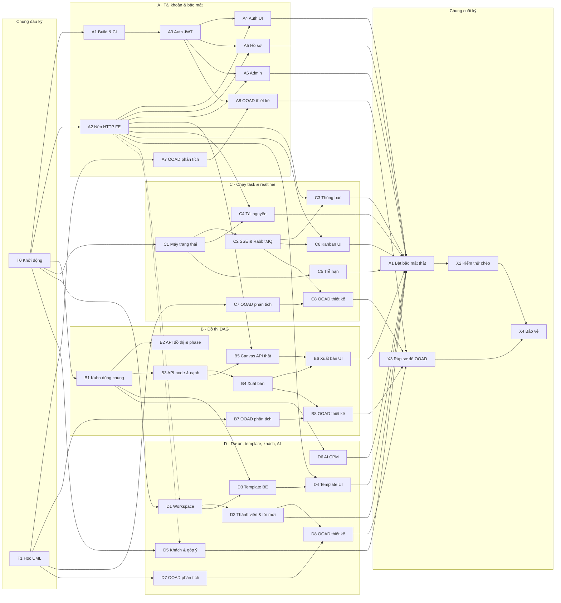

# Kế hoạch chia việc 4 người — Workflow Pipeline Engine

> Lập ngày 11/11/2026, sau khi đọc code và tài liệu trong repo. Mỗi task là một file `.md`. Dán file đó cho Claude là làm được, nhưng **người làm phải tự làm các bước 🧠 và trả lời được "Câu hỏi bảo vệ"** thì task mới được tính là xong.

**Mỗi người chỉ cần mở thư mục của mình** (trong mỗi thư mục có `README.md` ghi thứ tự làm):

| Thư mục | Của ai | Nội dung |
| :--- | :--- | :--- |
| [A-tai-khoan/](A-tai-khoan/README.md) | A | A1–A8: tài khoản, bảo mật, hạ tầng, OOAD mảng A |
| [B-do-thi/](B-do-thi/README.md) | B | B1–B8: đồ thị DAG, Kahn, xuất bản, OOAD mảng B |
| [C-thuc-thi/](C-thuc-thi/README.md) | C | C1–C8: máy trạng thái, realtime, thông báo, OOAD mảng C |
| [D-du-an/](D-du-an/README.md) | D | D1–D8: dự án, thành viên, template, khách, AI, OOAD mảng D |
| [chung/](chung/README.md) | cả nhóm | T0, T1 (đầu kỳ, mỗi người tự làm) và X1–X4 (cuối kỳ, làm chung) |
| [ghi-chep/](ghi-chep/README.md) | từng người | Ghi chép T0, T1 và biên bản |

> ⚡ **Cần xong trong 1–2 ngày? Làm theo [SPRINT_2_NGAY.md](SPRINT_2_NGAY.md)**: chọn task quan trọng nhất, Claude làm code và tự chạy test, mỗi task có một vòng hiểu 15–20 phút trước khi merge; bước cần trình duyệt gom về buổi kiểm chung.

> **Cập nhật 11/11/2026 sau khi pull code mới (Dev B):** đã có sẵn API đồ thị, phase, node, phụ thuộc, xuất bản (`WorkflowGraphController/Service`), `KahnDagService`, CRUD template (`PipelineTemplateController/Service`), `HttpTemplateService` trên FE, và migration **V5, V6**. Vì vậy:
> - B1–B6, D3, D4 đổi từ "viết mới" sang **"đọc hiểu, kiểm thử, vá lỗ hổng"** (các lỗ hổng cụ thể ghi trong từng file, và ở mục 10).
> - Số migration cấp lại: A5 → **V7**, D2 → **V8**, B2 → **V9** (mục 6.2).
> - `docs/MIDTERM_PROGRESS_REPORT.md` ghi **hạn nộp đồ án 15/11/2026**. Nếu đúng vậy, xem mục 5.1 (bản rút gọn).

## 1. Mục tiêu
1. Hệ thống chạy thật từ đầu đến cuối: đăng nhập thật, dữ liệu thật, không còn chỗ nào lặng lẽ rơi về dữ liệu giả, bảo mật bật thật.
2. Mỗi người làm **trọn một mảng** (backend + frontend + test + sơ đồ OOAD), nên ít phải sửa chung file và ít phải chờ nhau.
3. Xong hết thì **ai cũng nắm cả hệ thống**: tự làm 1 mảng, review rồi thuyết trình 1 mảng, kiểm thử chéo 1 mảng, luyện vẽ mảng còn lại.
4. Môn OOAD: mỗi người tự vẽ đủ các loại sơ đồ chính cho mảng của mình, cả nhóm ráp thành bộ sơ đồ nhất quán, rồi luyện vẽ không nhìn và vấn đáp.

## 2. Phân công

| Người | Mảng | Cụm trong integration map | Task code | Task OOAD |
| :--- | :--- | :--- | :--- | :--- |
| **A** | Tài khoản, bảo mật, hạ tầng | 1, 2, 10.1, 10.2 + nền HTTP frontend + build/CI | A1–A6 | A7, A8 |
| **B** | Thiết kế quy trình DAG | 4 + thư viện Kahn dùng chung | B1–B6 | B7, B8 |
| **C** | Chạy task và realtime | 5, 6 + thông báo, RabbitMQ, SSE, quét trễ hạn | C1–C6 | C7, C8 |
| **D** | Dự án, template, khách, AI | 3, 7, 8, 9, 10.3 | D1–D6 | D7, D8 |

**Vòng học chéo** (để ai cũng nắm cả 4 mảng):

| Người | Tự làm | Review suốt kỳ, thuyết trình ở X4 | Kiểm thử chéo ở X2 | Luyện vẽ không nhìn ở X4 |
| :--- | :--- | :--- | :--- | :--- |
| A | mảng A | mảng D | mảng C | mảng B |
| B | mảng B | mảng A | mảng D | mảng C |
| C | mảng C | mảng B | mảng A | mảng D |
| D | mảng D | mảng C | mảng B | mảng A |

Người review cố định: **A do B review, B do C review, C do D review, D do A review.**

**Khối lượng ước lượng** (ước lượng để chia đều, không phải số đo): mỗi người khoảng 9,5–12,5 ngày công cho 8 task riêng, cộng T0, T1 và 4 task chung X1–X4.

## 3. Danh sách task

| Mã | Tên | Người | Cần có trước | Ước lượng |
| :--- | :--- | :--- | :--- | :--- |
| [T0](chung/T0-khoi-dong.md) | Khởi động: chạy hệ thống, lần theo 1 yêu cầu xuyên tầng | mỗi người | — | 0,5–1 ngày |
| [T1](chung/T1-hoc-ky-hieu-uml.md) | Học ký hiệu UML, luyện chung 1 bài | mỗi người | — | 1 ngày |
| [A1](A-tai-khoan/A1-ha-tang-build-ci.md) | Hạ tầng build, test, CI | A | T0 | 0,5–1 |
| [A2](A-tai-khoan/A2-nen-http-frontend.md) | Nền HTTP frontend, bỏ fallback ngầm | A | T0 | 1–1,5 |
| [A3](A-tai-khoan/A3-dang-nhap-jwt.md) | Đăng ký, đăng nhập, JWT, refresh token | A | A1 | 2–2,5 |
| [A4](A-tai-khoan/A4-dang-nhap-giao-dien.md) | Đăng nhập trên giao diện, tự refresh | A | A2, A3 | 1–1,5 |
| [A5](A-tai-khoan/A5-ho-so-ca-nhan.md) | Hồ sơ, đổi mật khẩu, ảnh đại diện | A | A2, A3 | 1,5–2 |
| [A6](A-tai-khoan/A6-quan-tri-admin.md) | Admin: người dùng, workspace | A | A2, A3 | 1,5 |
| [A7](A-tai-khoan/A7-ooad-phan-tich.md) | OOAD phân tích mảng A | A | T1 | 1 |
| [A8](A-tai-khoan/A8-ooad-thiet-ke.md) | OOAD thiết kế mảng A | A | A7, A3 | 1–1,5 |
| [B1](B-do-thi/B1-kahn-backend.md) | Kahn: kiểm thử, hoàn thiện `KahnDagService` | B | T0 | 0,5–1 |
| [B2](B-do-thi/B2-api-do-thi-giai-doan.md) | API đồ thị và phase: lưu vị trí, chặn ARCHIVED | B | B1 | 1 |
| [B3](B-do-thi/B3-api-node-phu-thuoc.md) | API node và phụ thuộc: vá 4 lỗ hổng | B | B1 | 1,5 |
| [B4](B-do-thi/B4-xuat-ban-du-an.md) | Xuất bản dự án: vá `publishPipeline` | B | B3 | 0,5–1 |
| [B5](B-do-thi/B5-canvas-goi-api-that.md) | Canvas gọi API thật | B | A2, B3 | 2 |
| [B6](B-do-thi/B6-xuat-ban-giao-dien.md) | Xuất bản trên giao diện, đồng bộ Kahn FE/BE | B | B4, B5 | 1 |
| [B7](B-do-thi/B7-ooad-phan-tich.md) | OOAD phân tích mảng B | B | T1 | 1 |
| [B8](B-do-thi/B8-ooad-thiet-ke.md) | OOAD thiết kế mảng B | B | B7, B4 | 1–1,5 |
| [C1](C-thuc-thi/C1-may-trang-thai-task.md) | Máy trạng thái task: kiểm thử và sửa lỗi | C | T0 | 1,5–2 |
| [C2](C-thuc-thi/C2-realtime-rabbitmq.md) | Realtime SSE và RabbitMQ | C | C1 | 1,5–2 |
| [C3](C-thuc-thi/C3-thong-bao.md) | Thông báo: API và chuông | C | A2, C2 | 1,5 |
| [C4](C-thuc-thi/C4-kho-tai-nguyen.md) | Kho tài nguyên và minh chứng | C | A2, C1 | 1 |
| [C5](C-thuc-thi/C5-quet-tre-han.md) | Quét task trễ hạn | C | C1 | 0,5–1 |
| [C6](C-thuc-thi/C6-kanban-giao-dien.md) | Kanban với backend thật và realtime | C | A2, C2 | 1,5–2 |
| [C7](C-thuc-thi/C7-ooad-phan-tich.md) | OOAD phân tích mảng C | C | T1 | 1 |
| [C8](C-thuc-thi/C8-ooad-thiet-ke.md) | OOAD thiết kế mảng C | C | C7, C2 | 1–1,5 |
| [D1](D-du-an/D1-workspace-du-an.md) | Workspace, tạo dự án, trạng thái dự án | D | T0 (bước FE cần A2) | 1–1,5 |
| [D2](D-du-an/D2-thanh-vien-loi-moi.md) | Thành viên, lời mời, chuyển quyền sở hữu | D | D1 | 1,5–2 |
| [D3](D-du-an/D3-template-backend.md) | Template backend: phân quyền ADMIN, kiểm clone | D | B1, D1 | 1 |
| [D4](D-du-an/D4-template-giao-dien.md) | Template Studio: lỗi rõ ràng, test, chạy thật | D | A2, D3 | 1 |
| [D5](D-du-an/D5-cong-khach-gop-y.md) | Cổng khách, góp ý: bảo mật và giao diện | D | T0 (bước FE cần A2) | 1–1,5 |
| [D6](D-du-an/D6-ai-duong-gang-cpm.md) | AI: đường găng CPM, Gemini tùy chọn | D | B1 | 1,5–2 |
| [D7](D-du-an/D7-ooad-phan-tich.md) | OOAD phân tích mảng D | D | T1 | 1 |
| [D8](D-du-an/D8-ooad-thiet-ke.md) | OOAD thiết kế mảng D | D | D7, D2 | 1–1,5 |
| [X1](chung/X1-bat-bao-mat-that.md) | Bật bảo mật thật toàn hệ thống | A chính, C, B, D | mọi task code chính (xem file) | 1 |
| [X2](chung/X2-kiem-thu-cheo.md) | Kiểm thử chéo end-to-end | cả nhóm | X1 | 1 |
| [X3](chung/X3-rap-bo-so-do-ooad.md) | Ráp bộ sơ đồ OOAD, kiểm nhất quán | cả nhóm | A8, B8, C8, D8 | 1 |
| [X4](chung/X4-bao-ve-va-luyen-ve.md) | Thuyết trình chéo, luyện vẽ, vấn đáp | cả nhóm | X2, X3 | 0,5–1 |

## 4. Sơ đồ phụ thuộc

Mũi tên `X --> Y` nghĩa là Y cần X xong trước. Mũi tên nét đứt là phụ thuộc chỉ của bước frontend.



**Hai task phải xong sớm nhất**, vì nhiều task của người khác cần chúng:
- **A2** (nền HTTP frontend) — 8 task cần: A4, A5, A6, B5, C3, C4, C6, D4, cộng bước FE của D1, D5.
- **B1** (Kahn dùng chung) — D3 và D6 cần.
Cả hai nên xong trong **2 ngày đầu**. Trong lúc chờ, ai cũng có việc backend của mảng mình để làm, nên không ai phải ngồi không.

## 5. Thứ tự đề xuất

| Người | Thứ tự làm |
| :--- | :--- |
| A | T0, T1 → **A1 → A2** → A3 → A7 → A4 → A5 → A6 → A8 |
| B | T0, T1 → **B1** → B2 → B7 → B3 → B4 → B5 → B6 → B8 |
| C | T0, T1 → C1 → C7 → C2 → C5 → C3 → C4 → C6 → C8 |
| D | T0, T1 → D1 (phần BE) → D5 (phần BE) → D7 → D2 → D3 → D6 → D1/D5 (phần FE) → D4 → D8 |
| Cả nhóm | X1 → X2; X3 → X4 |

Lịch gợi ý cho 4 tuần (thời gian ít hơn thì giữ nguyên thứ tự, nén lịch lại):
- **Tuần 1:** T0, T1 (cùng họp so bài T1), A1, A2, B1, rồi task backend đầu tiên của mỗi mảng. Cuối tuần làm task OOAD phân tích (A7–D7).
- **Tuần 2:** các task backend còn lại của mỗi mảng.
- **Tuần 3:** các task frontend, nối API thật.
- **Tuần 4:** OOAD thiết kế (A8–D8), rồi X1, X2, X3, X4.

### 5.1 Bản rút gọn nếu chỉ còn vài ngày
Ưu tiên theo thứ tự, làm song song theo người:
1. **Mọi người, ngày 1:** T0 rút gọn (chỉ bước 2–7: chạy được hệ thống và thực hành Swagger), T1 (luyện vẽ chung).
2. **OOAD trước** (vì là phần nộp và chấm): A7, B7, C7, D7 → A8, B8, C8, D8 → X3. Sơ đồ thiết kế vẽ theo code hiện có, đánh dấu "dự kiến" chỗ chưa code.
3. **Vá lỗi nặng nhất của mảng mình**, mỗi người 1–2 task: A2 (bỏ fallback ngầm) và A3 (đăng nhập thật); B3 (vòng dài lọt qua, Viewer sửa được đồ thị); C1 (gửi sự kiện trước commit); D1 (IDOR clone) và D3 (phân quyền template).
4. **X4** (thuyết trình chéo, luyện vẽ, vấn đáp) trước buổi bảo vệ.
Các task còn lại để sau hạn nộp nếu nhóm còn làm tiếp.

**Hạn OOAD tới sớm hơn code:** làm A7–D7 ngay tuần 1, rồi A8–D8 dựa trên code hiện có cộng đặc tả, đánh dấu "dự kiến" ở phần chưa code. Code xong thì cập nhật sơ đồ cho khớp.

## 6. Luật chung để không đụng nhau

### 6.1 File dùng chung có chủ
> Viết tắt: `BE/` = `wpe-backend/src/main/java/com/pipeline/wpe/`, `FE/` = `wpe-frontend/src/`.

| File / khu vực | Chủ | Người khác được làm gì |
| :--- | :--- | :--- |
| `BE/security/**`, `BE/exception/GlobalExceptionHandler.java`, `ErrorResponse.java` | A | Được **thêm** handler mới ở cuối file cho exception mới của mảng mình. Sửa handler cũ hay đổi `ErrorResponse`: hỏi A |
| `application.yml`, `pom.xml`, `.gitignore`, `.github/**` | A | Thêm key mới cho mảng mình thì ghi rõ trong PR. Sửa key cũ hay thêm thư viện: hỏi A và báo nhóm |
| `db/migration/**` | theo số đã cấp (6.2) | Không sửa file đã merge, kể cả của chính mình |
| `StateMachineService`, `SseEmitterService`, `WorkflowEventPublisher`, `WorkflowEventConsumer`, `RabbitMQConfig`, `NodeMapper` | C | Được **gọi** hàm public. Cần đổi gì thì nhờ C |
| `ProjectAuthorizationService`, `ProjectService`, `ProjectInvitationService`, `TemplateCloneService` | D | Được gọi. Cần thêm hàm thì nhờ D |
| `BE/service/engine/KahnDagService.java`, `PhaseProgressCalculator.java`, `BE/service/WorkflowGraphService.java`, `BE/controller/WorkflowGraphController.java` | B | Được gọi. Cần thêm gì thì nhờ B |
| `BE/service/PipelineTemplateService.java`, `BE/controller/PipelineTemplateController.java` | D | Được gọi. Cần thêm gì thì nhờ D |
| `BE/repository/*.java` | mảng sở hữu entity | Ai cũng được **thêm** method mới. Sửa hay xóa method cũ: hỏi chủ |
| `FE/services/http/**`, `FE/services/env.ts`, `wpe-frontend/vite.config.ts`, `FE/App.tsx` | A | C chỉ sửa chỗ mở/đóng SSE trong `App.tsx` (C6) |
| `FE/services/container.ts` | A (cấu trúc) | Mỗi người chỉ đổi đúng dòng service của mảng mình |
| `FE/services/impl/http/*.ts` | `auth` (A), `graph` (B), `tasks`/`artifacts`/`realtime` (C), `workspace`/`invitations`/`guest`/`ai` (D) | Chỉ sửa file của mảng mình |
| `FE/services/impl/HttpWorkflowService.ts` | A (khung) | Mỗi người chỉ sửa các phương thức của mảng mình và dòng tương ứng trong `METHODS_STILL_MOCKED` |
| `FE/store/slices/settingsSlice.ts` | D | B chỉ sửa phần `publishPipeline` |
| `FE/types/*.types.ts` | auth/profile/admin (A); workflow (B); kanban/artifact/notification (C); workspace/settings/guest/overview/template (D) | |
| `docs/FRONTEND_BACKEND_INTEGRATION_MAP.md` | mỗi người sửa đúng các cụm của mình | |
| `docs/specs/database-schema.md` | người tạo migration sửa đúng bảng mình đổi | |
| `docs/archive/**` | **không ai sửa** | |

### 6.2 Số migration Flyway đã cấp
| Số | Đã cấp cho | Nội dung |
| :--- | :--- | :--- |
| V5 | **đã dùng** (Dev B, đã merge) | Seed template mẫu, cột `slug` của `pipeline_template` |
| V6 | **đã dùng** (Dev B, đã merge) | Bảng `phase_dependency` |
| V7 | A (task A5) | Cột hồ sơ người dùng |
| V8 | D (task D2) | Sửa unique của lời mời |
| V9 | B (task B2) | Cột `work_phase.ui_metadata` |
| V10 | D (lịch sử thành viên, chờ nhóm xác nhận) | Unique `project_member` chỉ cho dòng còn hiệu lực |
| V11 | D (template riêng của user, chờ nhóm xác nhận) | Cột `visibility`, `source_project_id` của `pipeline_template` |
| V12 | A (fix FA1, đợt fix lỗi 13/11) | Đặt lại hash mật khẩu seed `admin`, `alex.kim`, `sarah.chen` |
| V13 | A (fix FA3, đợt fix lỗi 13/11) | Bảng `admin_audit_log` (nhật ký hệ thống của admin) |
| V14 | D (ẩn/hiện template mẫu, quyết định nhóm 14/11) | Cột `pipeline_template.is_hidden` |
| V15 trở đi | xin trong nhóm chat, rồi ghi thêm dòng vào bảng này bằng 1 commit nhỏ **trước** khi tạo file | |

A1 bật `spring.flyway.out-of-order: true` cho giai đoạn dev, nên merge lệch thứ tự (ví dụ V9 vào trước V8) vẫn chạy được. Gặp lỗi Flyway lạ trên máy mình thì có thể làm lại DB bằng `docker compose down -v && docker compose up -d` (**xóa sạch dữ liệu local**).

### 6.3 Chế độ dev và địa chỉ API
- Mọi endpoint mới đặt dưới `/api/v1/...`. Frontend dùng base `http://localhost:8080/api/v1` (A2).
- Cho tới X1: test bằng Swagger với header `X-Debug-User-Id`: `1` = admin, `2` = alex.kim (Owner dự án mẫu), `3` = sarah.chen (Collaborator). Mật khẩu chung của các tài khoản mẫu: xem `README.md` gốc của repo.
- API admin (A6) và mọi chỗ dùng `@PreAuthorize` cần **JWT thật** ngay từ đầu.

### 6.4 Hàm dùng chung: không được đổi chữ ký
`SseEmitterService.sendToUser(Long, String, Object)` · các hàm `WorkflowEventPublisher.publish*` · `ProjectAuthorizationService.verifyProjectOwner` và `verifyProjectMemberOrOwner` · `CurrentUserProvider.requireCurrentUserId()` · `KahnDagService.validateProjectDag` và `validateTemplateGraph`.

### 6.5 Nhánh, PR, review
- Mỗi task 1 nhánh (tên ghi trong file task), 1 PR nhỏ. Rebase lên `main` trước khi mở PR. CI (từ A1) phải xanh.
- Mô tả PR gồm: mã task; đã làm gì; output test thật; link tới phần "Ghi chép của người làm".
- Người review **phải** hỏi "Câu hỏi bảo vệ" (gặp mặt hoặc gọi điện, người làm trả lời không nhìn code). Đây cũng là cách người review học mảng đó để thuyết trình ở X4.

## 7. Quy trình làm một task
1. Chạy `node docs/tasks/tien-do.mjs`, kiểm các task trong "Cần có trước" đã `xong`.
2. Tạo nhánh, đổi dòng `Trạng thái:` thành `đang làm`.
3. **Bước 0**: tự đọc, tự trả lời vào "Ghi chép của người làm". **Không dùng AI.**
4. Làm các bước theo ký hiệu:
   - 🧠 = **tự làm**. AI chỉ được gợi ý và chỉ chỗ sai, không viết hộ.
   - 🤝 = **làm cùng AI**. AI viết, bạn đọc hiểu từng dòng và giải thích lại được.
5. Chạy test, dán **output thật** vào ghi chép.
6. Điền ghi chép, đổi `Trạng thái: chờ kiểm`, mở PR.
7. Người review đọc ghi chép → kiểm "Tiêu chí xong" → hỏi "Câu hỏi bảo vệ".
   - Đạt: người review đổi `Trạng thái: xong` (commit trong PR) rồi merge.
   - Không đạt: đổi `Trạng thái: làm lại`, ghi lý do vào PR.
8. Người có task phụ thuộc pull `main` rồi mới bắt đầu.

## 8. Dùng file task với Claude
- **Claude Code** (mở trong repo): gõ `Đọc docs/tasks/A-tai-khoan/A3-dang-nhap-jwt.md và làm theo mục "Dành cho Claude". Mình là người làm.`
- **claude.ai** (chat): dán nội dung file task, kèm nội dung các file cần thiết trong mục "Được đọc". **Không dán `.env`, mật khẩu, khóa.**
- Mỗi file task đã có mục "Dành cho Claude". Tóm tắt quy tắc chung:
  1. Hỏi người làm tóm tắt mục tiêu và câu trả lời Bước 0 trước khi code.
  2. Không làm hộ bước 🧠. Bước 🤝 thì làm từng phần nhỏ, có giải thích.
  3. Chỉ sửa file trong "Được ghi"; gặp file dùng chung thì dừng lại hỏi.
  4. Không tự đổi "Đặc tả đã chốt"; thấy sai thì báo.
  5. Không đọc `.env*`, khóa, mật khẩu. Không chạy lệnh xóa dữ liệu (ví dụ `docker compose down -v`) khi người làm chưa đồng ý.
  6. Báo đúng sự thật: test lỗi thì nói lỗi, chưa chạy thì nói chưa chạy.
  7. Xong thì hỏi 3 câu bảo vệ, chỉ đổi trạng thái thành `chờ kiểm`.

## 9. Các quyết định thiết kế đã chốt
| Quyết định | Lý do | Task |
| :--- | :--- | :--- |
| Mỗi dự án chỉ có 1 chủ = `project.owner_id`. Đổi role thành OWNER nghĩa là chuyển quyền sở hữu | Mọi chỗ đang kiểm `project.getOwnerId()` vẫn đúng, không phải sửa mảng của người khác | D2 |
| Dự án mới ở trạng thái `DRAFT`. Xuất bản nhận cả `DRAFT` và `PLANNING`. DRAFT → ACTIVE chỉ qua xuất bản | Khớp SSOT, vẫn tương thích dữ liệu cũ | D1, B4 |
| Cạnh giữa các phase: bảng `phase_dependency` (nhiều-nhiều) — **đã làm ở V6**; còn thêm `work_phase.ui_metadata` để lưu vị trí phase | FE cho phase nhiều cha, DB cũ chỉ có 1 cha | B2 |
| Kahn ở backend dùng chung là `KahnDagService` (đã có); `cycleNodes` đổi sang cách "bóc ngược", thêm `sortedOrder` và `wouldCreateCycle` | Báo đúng node nằm trên chu trình, không báo nhầm node đứng sau chu trình | B1 |
| Lưu tọa độ và đánh dấu trễ hạn **không** làm tăng `version` | Không gây 409 oan cho người đang thao tác Kanban | B3, C5 |
| Gửi sự kiện RabbitMQ và SSE **sau commit** | Consumer luôn đọc được dữ liệu đã lưu | C1, B4 |
| `graph_data` của template = `GraphDataPayload` (schemaVersion 2) của FE | Template Studio là nơi tạo ra dữ liệu này | D3 |
| Clone chỉ đọc từ `pipeline_template` | Chặn lỗ hổng clone dự án của người khác (IDOR) | D1 |
| Chỉ OWNER gửi lời mời | Đúng UC8 trong SSOT | D2 |
| HTTP frontend không còn fallback ngầm; phương thức chưa có backend nằm trong `METHODS_STILL_MOCKED` | Lỗi phải lộ ra khi test | A2 |
| Ảnh đại diện lưu ở thư mục `uploads/` trên server, không đưa vào git | Đơn giản, đủ cho đồ án | A5 |
| Token SSE đi qua query `access_token`, **chỉ** cho `/realtime/subscribe` | EventSource không gửi được header | X1 |
| Danh mục sự kiện SSE: `INIT`, `PING`, `TASK_UNLOCKED`, `TASK_STATUS_CHANGED`, `TASK_SUBMITTED`, `TASK_REJECTED`, `NOTIFICATION_RECEIVED` | FE và BE dùng chung một danh sách | C2 |
| Fixture test DAG chung đặt ở `shared/test-fixtures/dag-cases.json` | Hai bản Kahn FE/BE cho cùng kết quả | B6 |

## 10. Lỗi và rủi ro phát hiện khi đọc code (11/11/2026)
Những mục ghi "cần xác nhận" là suy ra từ việc đọc code, chưa chạy thử. Task tương ứng có bước tái hiện.

| Vấn đề | Task xử lý |
| :--- | :--- |
| Giả danh người dùng được qua `?currentUserId=` / `?userId=`; có fallback `orElse(2L)`, `orElse(1L)` (NodeController, RealtimeController, ArtifactController) | X1, C4 |
| Chưa có `AuthController`; `SecurityConfig` đang `permitAll`; `jwt.secret` nằm trong `application.yml` | A3, X1 |
| `HttpWorkflowService` tự rơi về mock khi lỗi; `.env.example` dùng base `/api` trong khi một số controller chỉ có `/api/v1`; `VITE_USE_MOCK` được hiểu 3 kiểu | A2 |
| Test FE `WorkflowArtifacts.test.tsx` lỗi; log cho thấy test chạy qua HTTP thay vì mock | A2 |
| Thiếu `mvnw`, máy chưa có Maven, chưa có CI | A1 |
| Unique `(project_id, invitee_id, status)` làm lỗi khi từ chối lời mời lần 2 (cần xác nhận) | D2 |
| Thành viên đã bị xóa mềm chấp nhận lời mời mới có thể bị chèn trùng (cần xác nhận) | D2 |
| Clone: đã ưu tiên template, nhưng không có template trùng id thì vẫn clone **dự án** đó mà không kiểm quyền (IDOR) | D1 |
| CRUD template không kiểm ADMIN, có `orElse(1L)`; template hệ thống xóa được | D3 |
| `TaskCompletedEvent` được gửi trước khi commit, task con có thể không mở khóa (cần xác nhận) | C1 |
| SSE chỉ 1 emitter mỗi user; đóng tab cũ có thể gỡ nhầm emitter tab mới; không có heartbeat; gửi thẳng entity | C2 |
| Sự kiện lời mời đi vào hàng đợi notification sai kiểu, 2 hàm handle không có `@RabbitListener` (cần xác nhận) | C2 |
| Nộp bài luôn đặt `isPublicForGuest = true`; chưa kiểm URL artifact | C4 |
| Đồ thị (code mới): nối node chỉ chặn vòng 2 node; Viewer sửa được đồ thị; lưu tọa độ làm tăng `version`; không tính lại trạng thái node khi đổi cạnh; chưa có PUT/DELETE node | B1, B3 |
| Xuất bản (code mới): dự án ARCHIVED vẫn xuất bản được; không gửi SSE cho task vừa mở khóa | B4 |
| Vị trí phase trên canvas không được lưu; dự án ARCHIVED vẫn sửa được đồ thị | B2 |
| `WorkflowGraphController`, `PipelineTemplateController` (code mới) cũng có `?currentUserId=` và `orElse(...)` | X1 |
| DB chưa có cột hồ sơ và ảnh đại diện | A5 |
| AI: `criticalPath` chỉ liệt kê mọi node, chưa phải CPM | D6 |
| Sơ đồ use case cũ trong archive vẽ bằng flowchart, có use case trái SSOT ("Claim Task", "phản hồi giải trình feedback") | D7, X3 |

## 11. Xem tiến độ
```bash
node docs/tasks/tien-do.mjs          # bảng tất cả task + task có thể bắt đầu của từng người
node docs/tasks/tien-do.mjs --nguoi C  # chỉ xem của C
```
Tool đọc dòng `Trạng thái:` trong từng file task (riêng T0 và T1 đọc ở `ghi-chep/T0-<chữ>.md`, `ghi-chep/T1-<chữ>.md`). Tool cũng báo lỗi nếu phụ thuộc trỏ tới mã không tồn tại, có vòng lặp phụ thuộc, hoặc dòng "Mở khóa" lệch với "Cần có trước". Bản thân tool cũng dùng thuật toán Kahn — B có thể đọc để so với B1.

Trạng thái hợp lệ: `chưa làm` · `đang làm` · `kẹt` · `chờ kiểm` · `làm lại` · `xong`. Chỉ người review được ghi `xong`.
